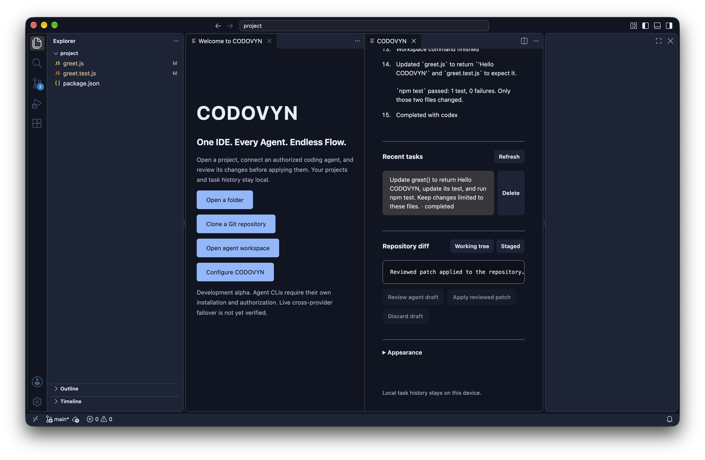
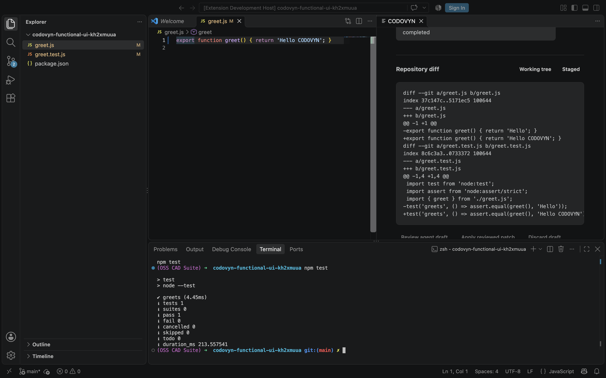

# CODOVYN

**One IDE. Every Agent. Endless Flow.**

CODOVYN is an open-source project building a local-first development environment that can preserve task context when a coding agent becomes unavailable. **Your code never stops when your agent does** is the product goal; the repository now includes a standalone macOS arm64 development application, with the companion VS Code extension retained. This is an unnotarized alpha, not a public release.

[](LICENSE) [](https://github.com/Gautam-aman/CODOVYN/actions/workflows/ci.yml)

## Standalone desktop

CODOVYN Desktop uses a pinned Code-OSS/VSCodium foundation with its own application identity, icon, data directories, welcome screen and ten full-workbench themes. It includes an editor, explorer, search, terminal, Git, language tooling and bundled Node 26/npm. VS Code and a globally installed Node runtime are not required to run the generated application. Agent-specific CLIs still require installation and authorization.

On **macOS arm64**, building from source requires Node 26, Git and Xcode command-line tools:

```sh
npm ci --ignore-scripts
npm run build:desktop
open dist/desktop/CODOVYN.app
npm run test:desktop-host
npm run package:desktop
```

Output: `dist/desktop/CODOVYN.app` and `dist/desktop/CODOVYN-darwin-arm64-development.dmg`. The development package is ad-hoc signed, not notarized. Windows and Linux desktop packaging is not implemented or tested. No public installer release is available.



This native-window capture shows a real authenticated Codex task in CODOVYN Desktop. It edited a greeting and its test in an isolated worktree; the displayed patch was explicitly reviewed and applied, and the resulting test passed. See the [desktop build guide](apps/desktop/README.md) and [architecture decision](docs/architecture/0003-standalone-foundation.md). Advanced routing, live cross-provider failover and bots remain unfinished.

## Shared runtime and companion extension

- A local SQLite task journal stores requests, agent events, checkpoints, and handoff history.
- A task engine switches to an ordered fallback after a structured quota or temporary failure when the repository is unchanged and no write-capable tool action ran. Explicitly marked Claude read/search actions can be retried; write-capable actions require reconciliation even if completion was recorded.
- Restart recovery checks the saved repository baseline before retrying a task with no write-capable tool action. Checkpoints record the real branch, commit, changed paths, and a local working-tree fingerprint.
- Codex CLI and Claude Code adapters consume structured stream events using the user's existing CLI authentication. An authenticated Codex read-only run and edit draft were verified locally on macOS; Claude and live provider failover remain unverified.
- A deterministic demo flow lets contributors inspect a simulated quota handoff without provider credentials or code edits.
- Ten optional panel themes provide dark, light, warm, and high-contrast palettes with live previews and local persistence. The default follows VS Code's configured theme. See the [theme guide and real preview](docs/contributing/themes.md).
- A CLI opens real Git repositories and displays saved task history.
- A VS Code extension panel selects a project folder in a multi-root workspace, starts local tasks, selects Codex, Claude, or automatic Codex-to-Claude fallback, shows a handoff timeline, and offers cancellation and confirmed history deletion. It can request an isolated edit draft and apply or discard it after review. Activation passed an automated host test on VS Code 1.142.0 for macOS. A live Codex task changed code and its test, streamed activity, displayed a draft diff, applied the reviewed patch through the panel, and passed tests in the integrated terminal. Demo history also persisted after restarting the host. Live Claude and provider-to-provider handoff remain unverified.
- Read-only Git patches, selected-path staging, local commits, branch creation, fetch, fast-forward-only pull, and an explicit branch push work through the CLI. Remote GitHub authentication still comes from the user's Git configuration.
- Read-only GitHub issue and pull-request lists, selected issue/PR details, bounded PR patch inspection, and Actions run listings work through an installed, authenticated GitHub CLI. Explicit CLI commands can create an issue or, after an interactive diff review, a same-repository PR. PR creation is covered by simulated tests but has not been exercised against GitHub. Automation bots are not implemented.



This is a genuine capture of a live coding task in a disposable repository on VS Code 1.142.0 for macOS. The two-file patch was reviewed and applied through the panel; `npm test` passed in the integrated terminal. See the [verification record](docs/development/validation-2026-10-21.md) for tested versions and remaining limits. The standalone development application is described above. GitHub bots, routing UI, and website remain planned work.

## Quick start

Requirements: Node.js 26 or newer and Git. These commands were verified on macOS with Node 26.9.0.

```sh
git clone https://github.com/Gautam-aman/CODOVYN.git
cd CODOVYN
git switch main
npm run check
node apps/cli/src/index.js demo . "Inspect this repository"
```

The demo creates a local task record in `~/.codovyn/tasks.sqlite` and prints the task ID. List tasks for the current repository and inspect one with:

```sh
node apps/cli/src/index.js tasks .
node apps/cli/src/index.js history TASK_ID .
```

To remove one task and its events, run `node apps/cli/src/index.js task-delete TASK_ID .`. To remove up to 100 finished tasks from one repository that were last updated before a timestamp, run `node apps/cli/src/index.js task-prune . 2026-01-01T00:00:00Z`. Both commands show what will be removed and require typing `delete` in an interactive terminal; scripts must pass `--yes`. Running or interrupted tasks are excluded from retention pruning. The database is local, but deletion does not erase copies in backups or guarantee secure erasure of SQLite pages. See [SECURITY.md](SECURITY.md).

For installed and authenticated agent CLIs, read-only tasks can be started with:

```sh
node apps/cli/src/index.js codex . "Explain the task engine"
node apps/cli/src/index.js claude . "Explain the task engine"
node apps/cli/src/index.js auto . "Explain the task engine"
```

The Codex and Claude commands are intentionally read-only and may use the provider accounts configured in their respective CLIs. The `auto` mode starts with Codex and tries Claude after a confirmed eligible failure or unavailability; it does not restore the primary agent. CODOVYN does not provide model access or an API entitlement. No CODOVYN account is needed. See the [Claude adapter guide](docs/agents/claude.md) for its current tool and version requirements.

For a code change, start from a clean committed repository and explicitly allow a separate Git worktree draft. The original working tree remains untouched until you review and apply the patch:

```sh
node apps/cli/src/index.js codex-edit . "Make a small change and run relevant checks" --allow-writes
node apps/cli/src/index.js draft-review TASK_ID .
node apps/cli/src/index.js draft-accept TASK_ID . PATCH_HASH --yes
```

Use `claude-edit` to restrict Claude Code to Read, Glob, Grep, Edit, and Write tools without shell commands. Use `auto-edit` to try Codex first and Claude after an eligible failure before any write-capable tool action. `draft-reject TASK_ID . --yes` discards the isolated worktree, including ignored build outputs. The VS Code panel asks for edit permission and patch application separately. Review the complete diff before accepting; CODOVYN does not yet provide per-hunk approval, automatic test execution after apply, or safe automatic handoff after a write action.

Git commands operate on a repository you name. Review changes with `node apps/cli/src/index.js diff .`, stage specific paths with `node apps/cli/src/index.js stage . path/to/file`, commit the index with `node apps/cli/src/index.js commit . "Describe change"`, and create and enter a local branch with `node apps/cli/src/index.js branch . feature/name`. Use `node apps/cli/src/index.js fetch .` to update remote-tracking refs, `node apps/cli/src/index.js pull .` to fast-forward a clean current branch, and `node apps/cli/src/index.js push .` only when intended. CODOVYN does not force-push or create a merge commit during pull. Its branch, commit, fetch, pull, and push commands skip repository Git hooks; run your project checks explicitly before committing or pushing. The 1 MiB limit applies to diff display, not to committing staged changes.

Install and authenticate the [GitHub CLI](https://cli.github.com/manual/gh_auth_login) to list open issues and pull requests:

```sh
node apps/cli/src/index.js issues OWNER/REPO
node apps/cli/src/index.js issue OWNER/REPO ISSUE_NUMBER
node apps/cli/src/index.js prs OWNER/REPO
node apps/cli/src/index.js pr OWNER/REPO PR_NUMBER
node apps/cli/src/index.js pr-diff OWNER/REPO PR_NUMBER
node apps/cli/src/index.js pr-preview OWNER/REPO BASE HEAD
node apps/cli/src/index.js runs OWNER/REPO BRANCH
```

These commands query only the repository you name. They return bounded metadata or a bounded patch and do not run code from issues or pull requests. See the [GitHub integration guide](docs/integrations/github.md) for current scope.

To create an issue deliberately, write its body to a Markdown file and run `node apps/cli/src/index.js issue-create OWNER/REPO "Issue title" path/to/body.md bug`. Label names are optional trailing arguments. This operation posts to GitHub with the user's `gh` authorization. Review the body and target repository before running it.

To inspect the outgoing diff without creating anything, use `node apps/cli/src/index.js pr-preview OWNER/REPO BASE HEAD`. To create a PR from two branches in the same GitHub repository, prepare a body file and run `node apps/cli/src/index.js pr-create OWNER/REPO BASE HEAD "PR title" path/to/body.md` in an interactive terminal. CODOVYN displays the target, title, body, and bounded GitHub comparison diff, then requires typing `create`. It checks the diff again before submitting. This path has only simulated creation tests; no live PR was created during CODOVYN development. See the [GitHub guide](docs/integrations/github.md) for limits.

To build a local VS Code extension archive, run `npm ci --ignore-scripts` and `npm run package:extension`. This produces `codovyn-dev.vsix`. Install it through VS Code's **Extensions → Install from VSIX…** action, open a Git repository folder, and run **CODOVYN: Open Agent Workspace** from the Command Palette. The panel streams task activity and lists saved tasks for that repository. The extension needs a Node.js 26 executable on your `PATH`; set `codovyn.nodePath` if necessary. The `codovyn-local` publisher identifier is for development packaging and is not a verified Marketplace publisher.

## Agent compatibility

| Agent | Authentication | Current behavior | Status |
| --- | --- | --- | --- |
| Deterministic demo agents | None | Simulated quota event and continuation, no edits | Tested locally |
| OpenAI Codex CLI | Existing CLI authentication | Read-only tasks or approved worktree edits, structured tool activity; no session resume | Simulated tests and one authenticated read-only and one draft edit run verified on macOS |
| Claude Code CLI | Existing CLI authentication | Read-only tasks or restricted worktree edits; no session resume or confirmed quota detection | Simulated tests only; CLI absent locally |
| Gemini CLI, OpenCode, ACP, local providers | Provider-specific | None yet | Planned |

The [Codex CLI reference](https://learn.chatgpt.com/docs/developer-commands?surface=cli) documents `codex exec --json` and read-only sandbox mode. [Claude Code's CLI reference](https://code.claude.com/docs/en/cli-reference) documents structured streaming and restricted tools. Neither adapter assumes that an unstructured error message proves quota exhaustion.

## Architecture

`packages/agent-core` defines the adapter registry and failure categories. `packages/agent-adapters` contains the Codex and Claude CLI bridges. `packages/storage` owns durable SQLite state. `packages/task-engine` coordinates runs and handoffs. `packages/git-engine` handles local repository operations. `packages/github-integration` handles issue and PR metadata through the GitHub CLI. `apps/cli` exposes the runtime, and `apps/vscode-extension` provides the editor panel.

The [local runtime decision](docs/architecture/0001-local-runtime.md) explains package boundaries, and the [handoff verification decision](docs/architecture/0002-repository-handoff-verification.md) explains repository checks and their limits. The [roadmap](docs/development/roadmap.md) records dependencies and the requested 100-commit target. Current progress must be read from Git history.

## Development

```sh
npm test
npm run check
npm run test:extension-host
```

The host test uses `@vscode/test-electron` and downloads VS Code unless `CODOVYN_VSCODE_EXECUTABLE` names an existing executable. On macOS, set `CODOVYN_HOST_SCREENSHOT=/path/to/capture.png` to capture the real host during the test. The runtime currently has no third-party npm dependencies; packaging uses `@vscode/vsce`. Node 26 supplies the SQLite module and test runner. Unit tests include a real temporary Git repository and simulated CLI processes; they do not spend provider quota. The CI workflow is configured for Linux, macOS, and Windows, but platform results must be checked in GitHub Actions.

See [CONTRIBUTING.md](CONTRIBUTING.md) for contribution steps and [SECURITY.md](SECURITY.md) for vulnerability reporting. Good first issues will be labeled in the [issue tracker](https://github.com/Gautam-aman/CODOVYN/issues).

## Roadmap

The next release gates are live Claude validation and provider-to-provider handoff, safe continuation after interrupted write actions, primary-agent restoration, complete Git/GitHub workflows, and security and accessibility verification. The standalone macOS development application has passed native editing, terminal and live Codex checks; desktop restart automation, Windows/Linux packages and public signing remain open. Optional cloud services remain planned. The current runtime must not be described as release-ready.

## License

Apache License 2.0. See [LICENSE](LICENSE).
