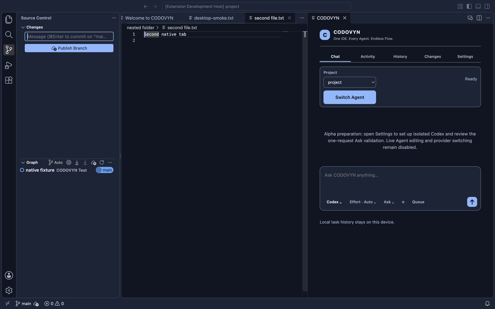
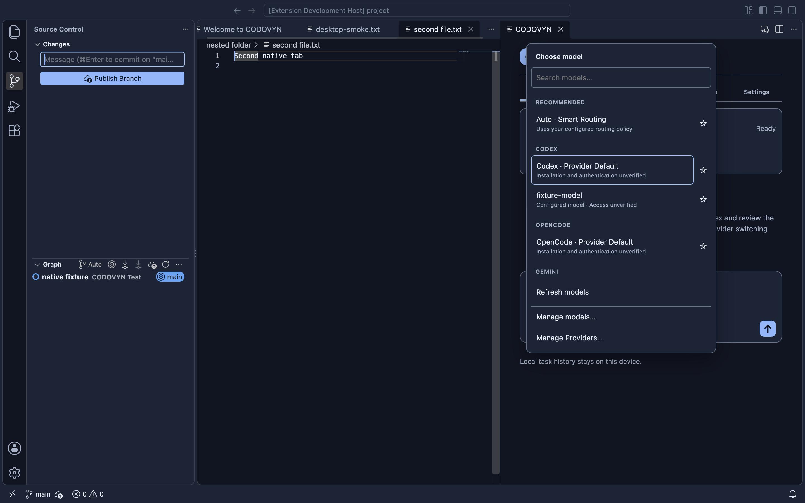
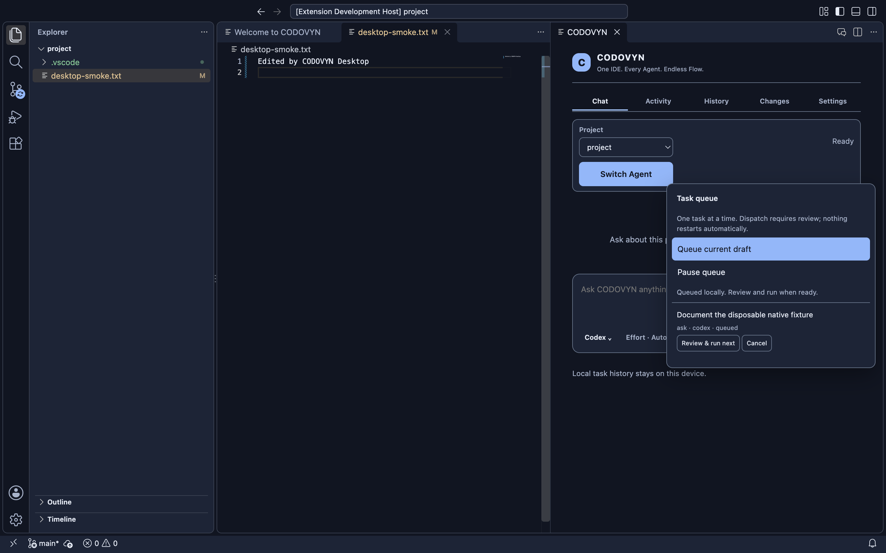
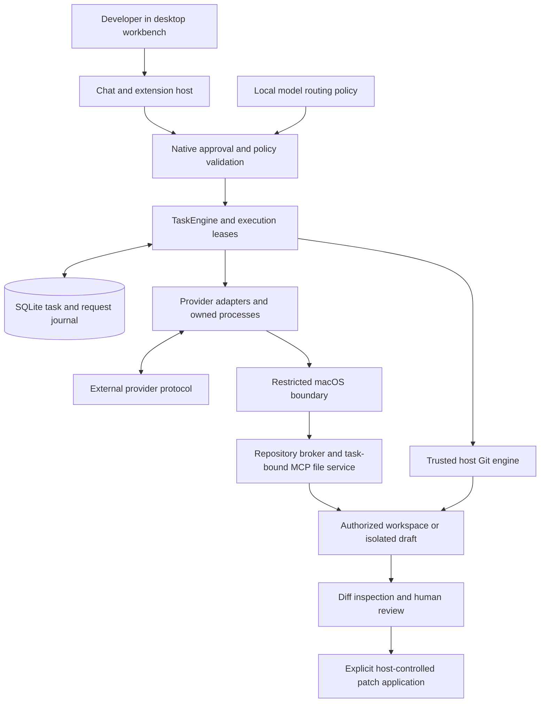
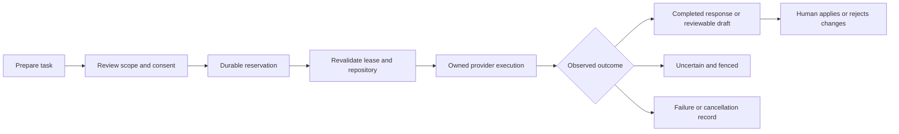

# CODOVYN

**One IDE. Every Agent. Endless Flow.**

**A desktop workspace for coding agents, verified task state and human-reviewed changes.**

CODOVYN is an independent **Code-OSS/VSCodium-based IDE** that brings the editor, terminal, Git, AI Chat and a durable agent runtime into one application. Its engineering focus is preserving the connection between a developer's request, the agent's permissions, observable work and the changes the developer ultimately accepts.

[](LICENSE)
[](docs/release/SUPPORTED-PLATFORMS.md)
[](docs/release/PUBLIC-ALPHA-READINESS.md)

[Documentation](#documentation) · [Build from source](#building-from-source) · [Architecture](#architecture) · [Contribute](CONTRIBUTING.md) · [Issues](https://github.com/Gautam-aman/CODOVYN/issues)

> **Current status:** `v0.1.0-alpha` is a release target, not a published release. There is no approved public installer and no verified successful live AI response or live coding workflow. Native IDE workflows and substantial agent infrastructure have automated qualification; general provider execution remains gated. The first approved OpenCode Ask received a provider-reported **HTTP 402 / insufficient account funds** error. Its request remains **uncertain and spent**, with further submission blocked. See [release readiness](docs/release/PUBLIC-ALPHA-READINESS.md) and the [funding investigation](docs/development/opencode-quota-funding-validation.md).

## Contents

- [Overview](#overview)
- [Features and availability](#features-and-availability)
- [Interface preview](#interface-preview)
- [Architecture](#architecture)
- [Installation](#installation)
- [Building from source](#building-from-source)
- [Getting started](#getting-started)
- [AI providers and models](#ai-providers-and-models)
- [Task lifecycle and review](#task-lifecycle-and-review)
- [Security and privacy](#security-and-privacy)
- [Project structure](#project-structure)
- [Technology stack](#technology-stack)
- [Development and testing](#development-and-testing)
- [Roadmap](#roadmap)
- [Contributing](#contributing)
- [Security disclosures](#security-disclosures)
- [License and acknowledgements](#license-and-acknowledgements)
- [Documentation](#documentation)

## Overview

Coding-agent work extends beyond a conversation. A useful development environment must track which repository an agent is operating on, what it may do, whether an operation actually completed, and which changes still require review. An interrupted provider request must not become an invisible retry or a lost draft.

CODOVYN brings that task state into a standalone engineering workspace. The desktop distribution assembles a pinned editor foundation, CODOVYN branding and workbench integration, and a bundled Node.js runtime. The extension host connects native dialogs and Chat to the shared local runtime; the application does not require a separately installed VS Code. The repository also retains an extension development target and CLI entry points.

The intended workflow combines explicit model selection, permission-scoped execution, durable task history and isolated edits. Agents prepare work; the developer retains control of approvals and application of changes. **ContextFlow** extends this design with bounded, verifiable context packets for reviewed provider continuation. Its implementation is tested deterministically; successful live cross-provider continuation is still unverified.

## Features and availability

**Available** means implemented with the stated local evidence, not a production-support promise. **Experimental** identifies implemented infrastructure awaiting broader qualification. **Restricted** means execution is gated. **Planned** means it is not established as a supported product capability.

| Capability | Status | Current implementation and limits |
| --- | --- | --- |
| Standalone desktop IDE | Available | macOS ARM64 development assembly; editor, Explorer, terminal, Git and CODOVYN workbench integration. |
| Engineering workspace | Available | Native editor/save, search, Git, Java/terminal and restart checks. Full Java language-server/debugger support requires separate compatible tooling. |
| Native Chat and activity | Available | Composer, provider/model controls, timeline, queue and history UI. Synthetic streaming tests do not establish live AI success. |
| Provider adapters | Experimental / Restricted | Codex, OpenCode, Claude and Gemini foundations; provider-specific validation and gates apply. |
| Models and effort | Available / Restricted | Search, favorites, recents and persisted selection. Reasoning or variants are exposed only where the adapter can enforce them. Catalogue presence does not prove access. |
| Local model routing | Experimental | Deterministic Auto, Economy, Balanced, Performance and Custom policies over an explicit catalogue. Scores and costs are configured inputs; no learned adaptive routing or hidden fallback. |
| Ask / Plan / Agent | Restricted | Read-only policies and approved draft policies are implemented. General live execution and live Agent coding remain blocked. |
| Draft editing and review | Experimental | Isolated Git worktrees, conflict-checked file changes, durable write intents, diff review and explicit apply/discard. Deterministic Java workflows are verified. |
| Task queue and lifecycle | Available | Persistent reviewed dispatch, repository fingerprints, execution ownership and cancellation. Queue dispatch does not override provider gates. |
| History and recovery | Available | SQLite task/event records, restart reconciliation and unresolved-operation fences; ambiguous writes are not replayed automatically. |
| Consent and accounting | Available | Recipient/model/scope-bound approval and durable request reservation before submission. Submission counts, tool calls, token reports and estimated cost are separate concepts. |
| Repository and file mediation | Experimental | Hardened macOS broker, descriptor-bound identity and task-bound MCP file tools; actual OS security witnesses exist for the pinned boundary. |
| ContextFlow | Experimental / Restricted | Versioned bounded packets, one-use recipient-bound approval and same-task provider segments. Live continuation and automatic fallback are not enabled. |
| Public distribution / other platforms | Planned | Developer ID signing, notarization and release gates remain open. Intel macOS, Windows and Linux native support is unverified. |

For the detailed evidence and remaining gates, use [public-alpha readiness](docs/release/PUBLIC-ALPHA-READINESS.md), [OpenCode task execution](docs/development/opencode-task-execution-validation.md) and [ContextFlow validation](docs/development/contextflow-validation.md). Historical phase reports describe their own checkpoints; they do not override current restrictions.

## Interface preview

These are existing captures of the real disposable desktop application. **Chat content and provider selections in qualification captures may be fixtures; none proves successful live inference.** They illustrate the interface, not an unrestricted execution entitlement.

<p align="center">
  
</p>

*Desktop workbench and Chat. Capture provenance: [public-alpha evidence](docs/assets/public-alpha/README.md).*

<p align="center">
  
</p>

*Model selection controls. Displayed entries are not evidence of account entitlement.*

<p align="center">
  
</p>

*Queue and task state, captured with deterministic fixtures. See [Phase 16 qualification](docs/development/phase16-live-multiagent-validation.md).*

## Architecture

The desktop shell and extension host share the same task, storage and Git packages as the CLI. Native host code owns admission and approvals; a webview or provider message cannot manufacture execution authority.



This is the implemented architectural path, **not a claim that every adapter can currently execute it live**. The guarded first-Ask path sends a reviewed fixed excerpt and grants no file tools. Metadata discovery follows a separate bounded path and never authorizes inference.

| Layer | Responsibility |
| --- | --- |
| Desktop assembly | Pinned VSCodium/Code-OSS workbench, application identity, themes, bundled runtime and development packaging. |
| Extension host | Chat, native settings/review dialogs, workspace integration and private worker lifecycle. |
| TaskEngine | Logical tasks, queue admission, repository ownership, execution segments, cancellation, recovery and ContextFlow approval. |
| Agent core and router | Validated task contracts, permission policy, context packets and deterministic catalogue selection. |
| Agent adapters | Provider protocols, stream normalization, process ownership, sandbox setup and broker/MCP mediation. |
| SQLite storage | Tasks/events, leases, request reservations, write intents and recovery records in the existing journal. |
| Git engine | Trusted repository inspection, fingerprints, draft worktrees, diffs and reviewed patch application. |

See the [architecture entry points](docs/release/ARCHITECTURE.md) and [standalone foundation decision](docs/architecture/0003-standalone-foundation.md).

## Installation

### Supported development target

- **Apple Silicon macOS / ARM64** is the only implemented desktop assembly target.
- The recorded qualification machine is Apple M2 with 8 GiB RAM on macOS 27.0.1. This is evidence for that environment, not a minimum-memory guarantee or a verified macOS support range.
- Assembly derives the minimum OS requirement from the editor and bundled runtime. A declared bundle minimum does not establish compatibility on every intervening OS release.
- Node is bundled for end users. Provider CLIs, accounts, Java, Maven and optional language tooling are separate installations.

See [platform scope](docs/release/SUPPORTED-PLATFORMS.md) for exact qualification details.

### Binary availability

**There is no published, approved public installer.** Build locally using the instructions below. `package:desktop` creates:

```text
dist/desktop/CODOVYN-darwin-arm64-development.dmg
```

It is **ad-hoc signed and unnotarized**, intended for development qualification. A valid ad-hoc signature is not Developer ID signing, notarization or clean-machine Gatekeeper acceptance. Do not disable macOS security protections or remove quarantine to work around a failed launch.

For copied-app verification, mount the image read-only, copy the app into a new disposable directory and test that copy. Never replace an existing installation during qualification. [Installation and removal](docs/release/INSTALLATION.md) covers data preservation and the future approved distribution path. Automatic upstream updates are disabled; upgrades require explicit validation.

## Building from source

Use **Node.js 26.12.1 or newer** as required by `package.json`; the artifact and CI qualification pin is **26.12.1**. Use npm and the committed lockfile. Desktop assembly also requires Git and Xcode Command Line Tools on macOS ARM64, plus network access for checksum-pinned build downloads.

```sh
git clone https://github.com/Gautam-aman/CODOVYN.git
cd CODOVYN
npm ci --ignore-scripts
npm run check
npm run build:desktop
open dist/desktop/CODOVYN.app
```

Repository access is required if visibility remains restricted. The build reads [artifacts.json](apps/desktop/artifacts.json), currently pinning VSCodium `1.140.06880` and Node `26.12.1`. It assembles the application under `dist/desktop`, preserving upstream notices. It replaces only its generated build output, not `/Applications/CODOVYN.app`.

To package and inspect the development image:

```sh
npm run package:desktop
hdiutil verify dist/desktop/CODOVYN-darwin-arm64-development.dmg
codesign --verify --deep --strict dist/desktop/CODOVYN.app
shasum -a 256 dist/desktop/CODOVYN-darwin-arm64-development.dmg
```

Record the checksum for **your** build; historical report checksums refer to different source commits. Packaging and integrity checks alone do not qualify installation, live AI execution or redistribution.

Java workflow tests use a Java 17 Maven/JUnit fixture with pinned cached dependencies. Install an appropriate JDK and Maven separately and prepare dependencies before running offline checks. The [development guide](docs/release/DEVELOPMENT.md) and [desktop build guide](apps/desktop/README.md) describe the remaining prerequisites and test isolation.

## Getting started

1. **Launch a development copy** and open a non-sensitive project through the native workspace controls.
2. **Review Workspace Trust.** Trust only a project you understand; it does not grant an AI provider unrestricted execution or authorize spending.
3. **Explore the editor first.** Open a file, save a small local change, inspect Git and use the integrated terminal. User-operated terminal access is distinct from agent tool authority.
4. **Open CODOVYN Chat → Settings.** Inspect provider installation, version and compatibility diagnostics. Use an application-level executable path if the installed CLI is outside the app's PATH.
5. **Configure an isolated provider context.** Authentication is an explicit owner action. Do not paste tokens into Chat or import global credentials. See the provider table below.
6. **Refresh models.** Choose only a discovered or validated entry; model metadata does not prove authentication, quota or supported coding execution.
7. **Review the mode and permissions.** Ask and Plan are read-only policies; Agent requires separate authority and an isolated draft. Current general live execution remains blocked.
8. **Inspect task history and diagnostics.** The narrowly scoped Calculator Ask review is a qualification entry point, not general Chat availability. It may refuse preparation while an uncertain request is fenced. Do not try to bypass that refusal.
9. **When a workflow is admitted**, review the native dialog's exact recipient, model, scope and quota implications before approval. Inspect activity, terminal status and any draft diff afterward; applying a patch is a separate decision.

A no-account runtime demonstration is available for contributors:

```sh
node apps/cli/src/index.js demo . "Inspect"
```

This exercises a **simulated handoff**. It neither contacts a model nor establishes live provider compatibility. No general real-coding quick start is claimed until that workflow is independently verified.

## AI providers and models

| Provider | Interface and setup | Current qualification |
| --- | --- | --- |
| OpenCode | Official pinned **2.1.2**, ACP JSON-RPC over stdio; owner-initiated official login in a separate project context. Native Setup uses `opencode auth login --standalone`. | Real Git-backed ACP sessions and model metadata verified; restricted task/MCP infrastructure tested. One approved Ask encountered a funding rejection with no response. Further submission is fenced. |
| Codex | Official pinned **0.164.0** native macOS ARM64 executable; official device flow in a stable isolated `CODEX_HOME`, with explicit Keychain storage and no plaintext fallback. | Authentication-only component and restricted coding boundary tested. Supported credential delegation into the coding process was not found; live coding bridge remains blocked. |
| Gemini CLI | Adapter, CLI detection and supported model selector; official CLI account setup. | Foundation and deterministic fixtures; managed-policy/authentication limitations remain. No current general live-coding claim. |
| Claude Code | Existing provider adapter and official CLI interface. | Foundation retained; routed model selection and current live qualification are incomplete. No automatic fallback entitlement. |

Guides: [OpenCode](docs/agents/opencode.md) · [Codex](docs/release/CODEX.md) · [Gemini](docs/agents/gemini.md) · [Claude](docs/agents/claude.md) · [Model picker](docs/agents/model-picker.md).

OpenCode discovery is lazy, bounded and refreshable; it checks the executable/version and repository authorization rather than treating cached catalogue entries as execution authority. The previous isolated context returned 39 models; that historical observation does not guarantee the same catalogue or usable access for another account.

Provider defaults, explicit model IDs, favorites and recents are persisted. Reasoning settings are provider/model-specific: unsupported controls must not silently do nothing. OpenCode variants are usable only when advertised and enforceable through the supported interface.

[Local routing](docs/agents/routing.md) evaluates explicitly configured capabilities, availability, quality/reliability inputs and optional cost estimates. It is a transparent policy heuristic, not measured model intelligence, learned adaptation, a hard spending cap or automatic provider switching.

**Accounts and charges:** catalogue labels, including “free” or open-weight entries, do not establish free account access. Subscription coverage, provider credits, API charges and model entitlement are separate questions. Authentication does not authorize a request. A host-submission limit does not cap internal provider calls, tokens or billing; cancellation may not immediately stop remote consumption. CODOVYN has no verified token-savings or lower-cost claim.

## Task lifecycle and review



This is a conceptual lifecycle; each adapter's exact reservation and admission boundaries are enforced in code. A queue entry is a persistent request for reviewed dispatch, not blanket execution permission. Dispatch rechecks repository state, model/configuration and ownership.

Streaming output, normalized activity and provider execution segments belong to the existing task journal. On cancellation, the host terminates owned processes and checks cleanup. Unverified cleanup retains an ownership fence instead of permitting conflicting execution.

For edits, the host creates an isolated worktree. Mediated changes require task-bound authority, conflict checks and a **durable SQLite write intent before mutation**. An interrupted or ambiguous write is reconciled rather than replayed. The original workspace remains protected until separate reviewed patch application.

A request reserved or possibly submitted remains accounted for after a crash. **Uncertain does not mean free to retry.** The current global campaign guard blocks a fresh submission while unresolved accounting exists; new credentials, restored credits or another approval do not clear it. Local dispatch is not a provider acknowledgement, and a provider error is not proof of zero billable work.

ContextFlow preserves the logical task while linking distinct provider segments. Packet integrity, recipient, permissions, current repository fingerprint and one-use approval are revalidated. There is no enabled unattended transfer. See [recovery](docs/agents/recovery.md) and [ContextFlow](docs/agents/contextflow.md).

## Security and privacy

The security model separates the UI, trusted host, provider process and workspace operations. Its strongest qualification is currently the **pinned macOS ARM64 boundary**; portable unit tests do not establish equivalent isolation on another platform.

- **Credentials:** isolated provider identities are not silently populated from global accounts. Codex Keychain access belongs to the trusted authentication component, not model-controlled tools. OpenCode owns authentication in its separate private context. Credential contents must never enter prompts, renderer messages, journals or public evidence.
- **Permissions:** Ask/Plan policies deny project mutation. Agent infrastructure confines approved edits to an isolated draft; native review is required before applying them. Authentication, Workspace Trust and model discovery are not execution consent.
- **Processes and Git:** the restricted provider boundary denies unrestricted shell, arbitrary Git, helpers, nested agents and unapproved executables. Trusted host Git operations remain distinct. The repository broker returns narrowly scoped metadata rather than acting as a general Git proxy.
- **Repository identity:** descriptor-bound checks distinguish repository/worktree identity from mutable branch/HEAD state. Tests cover freshness, nested repositories, path substitution, linked-worktree scope and controlled races. This is not a claim of complete race immunity.
- **Files and MCP:** task-bound file mediation validates scope, identity, versions and operation limits. Known credential paths, traversal and tested symlink/hardlink escape cases are denied. Provider-configured plugins, MCP servers and repository-local executable policy cannot silently expand authority.
- **Consent and accounting:** native approval binds scope and configuration; reservations precede submission. Unknown outcomes stay spent/fenced. Requests, internal model turns, tool calls, token reports and estimated prices must not be conflated.
- **Local data:** SQLite history is stored in a private directory; it is **not encrypted**. Deletion is not secure erasure, and backups or WAL pages may retain content. Campaign records are not removed by ordinary task retention.
- **External data:** approved prompt content, source excerpts or context packets may be transmitted to the selected provider. Ordinary source can contain secrets; path exclusions and redaction are not perfect. Review the actual scope before transferring it.

Read [SECURITY.md](SECURITY.md), [task execution validation](docs/development/opencode-task-execution-validation.md) and [broker qualification](docs/development/opencode-production-compatibility-validation.md). No absolute security or zero-data-collection guarantee is made. Current public-release gates include embedded runtime security, dependency exposure and distribution review.

## Project structure

```text
CODOVYN/
├── apps/
│   ├── desktop/            # Pinned desktop assembly, workbench integration, packaging
│   ├── vscode-extension/   # Chat, native host commands, approvals and worker controllers
│   └── cli/                # Shared runtime commands and isolated provider workers
├── packages/
│   ├── agent-core/         # Contracts, policy, context packets and usage provenance
│   ├── agent-adapters/     # Provider protocols, sandbox, broker and MCP/file mediation
│   ├── agent-router/       # Deterministic catalogue/routing policy
│   ├── task-engine/        # Lifecycle, queue, leases, recovery and handoff coordination
│   ├── storage/            # SQLite tasks, events, consent and write/request accounting
│   ├── git-engine/         # Trusted Git inspection, worktrees and patch review
│   └── github-integration/ # GitHub integration package
├── scripts/                # Build/test harnesses, security witnesses and qualification
├── docs/
│   ├── agents/             # Provider, routing, recovery and ContextFlow guides
│   ├── architecture/       # Architecture decisions
│   ├── development/        # Dated validation reports and engineering evidence
│   ├── release/            # Readiness, installation, redistribution and manual QA
│   └── assets/             # Screenshots and sanitized qualification artifacts
└── .github/                # CI workflows, issue templates and PR template
```

## Technology stack

| Technology | Role |
| --- | --- |
| Code-OSS / VSCodium | Editor/workbench foundation, Explorer, Git, terminal and extension-host APIs. |
| Electron / Chromium | Desktop runtime inherited through the pinned editor distribution. |
| JavaScript / Node.js | ESM runtime packages and CLI; CommonJS host integration; bundled Node 26.12.1. No TypeScript rewrite is implied. |
| SQLite / Node built-ins | Durable local task/event state, leases, request reservations and write intents. |
| ACP / JSON-RPC, CLI protocols | Provider communication through supported, version-specific interfaces. |
| MCP | Restricted authenticated task file tools; no arbitrary external tool-server grant. |
| Native macOS helpers / sandbox | Hardened repository/file mediation, executable integrity and process/filesystem restrictions. |
| Git | Host-controlled fingerprints, isolated worktrees, diffs and reviewed application. |
| Node test runner / native host harnesses | Deterministic unit/integration tests, OS witnesses and copied-application qualification. |
| macOS packaging tools | App assembly, development signing, DMG integrity and distribution verification gates. |

## Development and testing

Start with syntax and regression checks:

```sh
npm ci --ignore-scripts
npm run check
```

Run graphical and packaging checks **sequentially**, especially on limited-memory machines:

```sh
npm run test:extension-host
npm run build:desktop
npm run test:desktop-host
npm run test:desktop-chat
npm run test:desktop-routing-ui
npm run test:desktop-restoration
npm run package:desktop
```

For Java host qualification, use `CODOVYN_HOST_JAVA_VALIDATION=1 npm run test:desktop-host` after preparing the JDK/Maven fixture prerequisites. To test a copied app, native desktop harnesses support `CODOVYN_DESKTOP_APP=/absolute/path/to/CODOVYN.app`; use a disposable copy and isolated profiles. See [manual QA](docs/release/MANUAL-QA.md) for checks requiring owner interaction or another clean Mac.

The test suite covers provider fixtures, TaskEngine/SQLite state, malformed protocol input, request/write recovery, queue ownership, ContextFlow, draft review and native security witnesses. Actual OS/CLI tests require supported executables and host tools; deterministic fixtures do not need a paid account. An installed provider that differs from an integrity pin is not interchangeable with the qualified binary.

**Recorded qualification, 2026-10-28:** 447 full regression tests passed with zero failures/cancellations/skips; 54 focused checks passed. Clean copied-app extension-host, desktop host, Chat, routing and two-launch restoration checks passed. These are historical results, not results generated by reading this README or proof of live inference. See [exact environment and evidence](docs/development/opencode-quota-funding-validation.md).

[CI](.github/workflows/ci.yml), [desktop](.github/workflows/desktop.yml) and [alpha qualification](.github/workflows/alpha-qualification.yml) workflows exist. Hosted CI has been blocked before execution by account billing/spending restrictions; **no green hosted-CI claim is made**. Cross-platform unit jobs do not establish cross-platform desktop support. The historical native workspace-search stall, [issue #16](https://github.com/Gautam-aman/CODOVYN/issues/16), remains open without a verified root cause.

## Roadmap

| Stage | Scope |
| --- | --- |
| Implemented foundation | Standalone ARM64 workspace, native Chat, durable tasks/queue, model controls, isolated drafts, request/write journals and reviewed context infrastructure. |
| Current priorities | Resolve provider funding and uncertain-request handling through explicit owner-controlled gates; verify one genuine Ask and separately approved coding workflow; stabilize startup/search; qualify a secure editor runtime. |
| Release prerequisites | Developer ID signing, notarization, clean-machine/manual QA, supported OS scope, hosted CI restoration and complete redistribution review. |
| Deferred integrations | Live OpenCode Agent and ContextFlow continuation, broader provider qualification and more capable restricted coding workflows. |
| Longer-term direction | Evidence-backed routing and context efficiency, improved orchestration and additional platforms. No measured token savings, unattended failover or delivery dates are promised. |

The first alpha aims for one reliable, secure coding provider before expanding the supported integration surface. See [known issues](docs/release/KNOWN-ISSUES.md) and [readiness](docs/release/PUBLIC-ALPHA-READINESS.md).

## Contributing

Start with [CONTRIBUTING.md](CONTRIBUTING.md), [development setup](docs/release/DEVELOPMENT.md) and the [curated contributor backlog](docs/release/CONTRIBUTOR-BACKLOG.md). Report reproducible defects through the [bug template](.github/ISSUE_TEMPLATE/bug_report.yml); propose scoped improvements through the [feature template](.github/ISSUE_TEMPLATE/feature_request.yml). Check existing issues before opening another. Beginner-friendly candidates are described in the contribution guide; current issue labels and scope should be checked before starting.

Keep changes small and explain what changed, why, and exactly how it was verified. Pull requests should preserve user repositories, security gates, provider pins and existing assertions. Label fixtures, metadata probes, OS witnesses and real inference separately. No signing credential or paid provider account is required for ordinary documentation and deterministic test contributions.

Provider/security work needs review of admission, credential exposure, process ownership, recovery and accounting—not only a successful response. Never attach personal journals, raw provider logs, auth files or private worktrees. Follow the [code of conduct](CODE_OF_CONDUCT.md) and [PR template](.github/PULL_REQUEST_TEMPLATE.md). Repository visibility and access remain owner-controlled.

## Security disclosures

Use GitHub's **Report a vulnerability** feature as described in [SECURITY.md](SECURITY.md). If private reporting is unavailable, open an issue requesting a private contact channel **without exploit details or secrets**. Do not publicly disclose an unpatched vulnerability or invent an alternative reporting address.

## License and acknowledgements

CODOVYN-owned source retains the repository's **[Apache License 2.0](LICENSE)**. [NOTICE](NOTICE) distinguishes that source from upstream components; it does not relicense third-party material or grant trademark rights.

The standalone application builds on Code-OSS/VSCodium and includes separately licensed Electron, Chromium and Node.js distributions. Their license and third-party notices must remain in the bundle. Open VSX is configured for compatible extensions; Microsoft Marketplace and proprietary Copilot services are not configured. User-installed extensions and provider CLIs/accounts have independent terms and are not bundled inference entitlements.

[Redistribution review](docs/release/REDISTRIBUTION.md) covers upstream notices, fonts/assets, bundled extensions, dependency exposure and unresolved owner review. `node scripts/inventory-desktop-licenses.js` inventories notices in an assembled app; an inventory is not legal clearance. Building successfully does not establish redistribution rights for every bundled asset. This README neither changes the license nor declares the public binary cleared for release.

## Documentation

- [Release readiness and current blockers](docs/release/PUBLIC-ALPHA-READINESS.md)
- [Installation](docs/release/INSTALLATION.md) · [Platforms](docs/release/SUPPORTED-PLATFORMS.md) · [Known issues](docs/release/KNOWN-ISSUES.md)
- [Development](docs/release/DEVELOPMENT.md) · [Architecture](docs/release/ARCHITECTURE.md) · [Manual QA](docs/release/MANUAL-QA.md)
- [Providers and models](docs/agents/model-picker.md) · [Routing](docs/agents/routing.md) · [Recovery](docs/agents/recovery.md) · [ContextFlow](docs/agents/contextflow.md)
- [Distribution engineering](docs/release/DISTRIBUTION.md) · [Redistribution review](docs/release/REDISTRIBUTION.md)
- [Source repository](https://github.com/Gautam-aman/CODOVYN) · [Issues and feedback](https://github.com/Gautam-aman/CODOVYN/issues)

Explore the code, reproduce a workflow, or contribute a focused improvement. If CODOVYN's direction is useful to you, star the repository and help make its verified capabilities easier to use.
