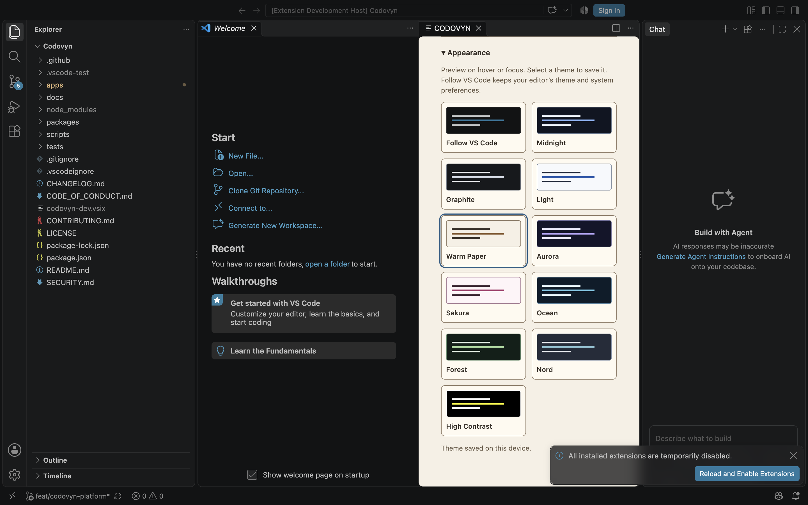

# Panel themes

CODOVYN follows the VS Code editor theme by default. Open **Appearance** in the
panel to preview Midnight, Graphite, Light, Warm Paper, Aurora, Sakura, Ocean,
Forest, Nord, or High Contrast. Hover or focus a preview, then select it to save
the choice on this device. Select **Follow VS Code** to return to editor theme
inheritance, including VS Code's configured system theme synchronization.

These presets style the CODOVYN panel. Editor fonts and syntax colors use VS
Code's own settings. Custom font controls, accent editing, and theme import or
export are not implemented yet.



This is a genuine capture from VS Code 1.142.0 on macOS. The host check verified
the rendered Warm Paper background and foreground, selection state, saved
preference, and temporary Ocean preview before restoring the saved selection.

## Contributing a palette

The palette catalog is `apps/vscode-extension/themes.cjs`. Each palette has a
stable ID, display name, light/dark color scheme, and ten tokens in the documented
`keys` order. `themeStyles()` maps those tokens to the VS Code color variables
inside the webview. Keep colors in this catalog instead of adding hardcoded
colors to component CSS.

Run the theme checks with:

```sh
node --test apps/vscode-extension/test/themes.test.js
```

The tests require at least 4.5:1 contrast for normal text, muted text, links,
errors, and button text, and 3:1 for control boundaries. Inspect focus states,
keyboard navigation, disabled controls, diff text, and narrow layouts in a real
extension host as well. Contrast tests do not establish complete accessibility.
