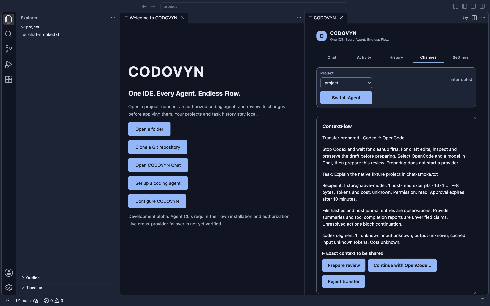

# ContextFlow validation — 2026-10-24

## Outcome and repository

ContextFlow packet preparation, durable one-use authorization, same-task continuation through the existing engine, review UI and deterministic safety tests are implemented. Native review and copied-installer regression checks passed. **Live authenticated Codex/OpenCode execution and real cross-provider continuation remain unverified.** No inference consent was received; no paid/quota-consuming test was run.

- Recoverable starting SHA: `677089e44192e6d8c9f144b040cdafe9188f9608`; clean `main`, correct remote, fetched and safely synchronized.
- Final implementation and embedded installer source: `2a3e9cc39facae9e4d15e71f805102b094326f02`; `sourceDirty: false`.
- Implementation commits below were each pushed and checked against `origin/main`. The report/evidence commit follows the packaged source; the accompanying completion message records the final branch SHA. No application code changes follow this build.
- Campaign count before this report commit: 157. No empty commits, branch, PR, release or visibility change. Repository remains private. Generated apps/DMGs are ignored, not committed. `/Applications/CODOVYN.app`, owner settings and projects were untouched.

```text
6d34396 feat(contextflow): add bounded provenance-aware packets and local source selection
c6451e8 feat(contextflow): require durable one-use approval for same-task continuation
843cd45 feat(ui): add explicit ContextFlow review and provider segment history
d482182 feat(contextflow): expose usage provenance and reproducible payload measurements
8e10571 test(desktop): verify persisted ContextFlow review and provider segments
81e59e3 fix(contextflow): invalidate handoff review when changing selected tasks
cc9a2ad fix(contextflow): bind continuation claims to the logical task identity
d8dc3aa test(contextflow): verify narrow high-contrast native review controls
5bd1ae4 fix(contextflow): reject stale automatic handoff eligibility
2a3e9cc fix(desktop): capture only the owned CODOVYN window in native tests
```

## Architecture and safety

The existing TaskEngine, SQLite journal, queue, isolated worktrees and adapter ownership contract remain the execution pipeline. New modules are `packages/agent-core/src/contextflow.js`, `contextflow-usage.js`, `packages/task-engine/src/contextflow.js` and `contextflow-files.js`. CLI and native host provide prepare/read/run/reject operations; no renderer-supplied packet, executable or approval hash authorizes execution.

The version-1 packet is bounded to **32 KiB UTF-8**, eight bounded source excerpts (2,048-character schema limit; the extractor budgets 2 KiB before redaction), 128 action records, six deduplicated recent provider reports and bounded instruction/evidence lists. Source selection is deterministic: tracked paths, changed draft paths, objective terms and common manifests. Reads reject symlinks, external paths, binary/invalid UTF-8 content and files above 64 KiB; source hashes and repository fingerprints are rechecked. Retrieval invokes no project code or model. There is no symbol/dependency graph or AI summarization in this implementation.

The original objective preserves user instructions. Explicit structured requirements/acceptance criteria can be supplied to the packet API; no unobserved decisions or completed work are invented. Host-read files and host journal observations are separated from provider claims and completion reports. Provider-reported test success never becomes independently verified test evidence. Hidden reasoning/session state is not transferred.

Known secret paths and common credential formats are excluded/redacted, including structured key assignments. This is best effort, not perfect detection: users inspect the exact shared packet before authorizing its recipient. Packet integrity checks detect altered storage; they are not a defense against an owner who can rewrite the entire local database.

```text
stopped Codex + verified cleanup + reconciled draft + no unresolved actions
  → prepared review (no execution, ten-minute expiry)
  → explicit native recipient/context approval
  → atomic one-use claim + repository execution lease
  → starting new OpenCode ACP session, same logical task ID
  → completed / interrupted / cancelled
prepared → rejected / expired
```

Preparation refuses unresolved operations, read-to-write escalation, changed original repositories and unreconciled draft modifications. Review binds packet/configuration digest, destination model/variant, executable/version, repository state and journal sequence. Dispatch performs fresh discovery and validation. The engine also rejects a transfer for another logical task. A newer unknown failure cannot reuse historical quota/unavailable eligibility. Manual switching still requires the same safety checks.

OpenCode remains pinned to the verified **macOS ARM64 / 2.1.2** boundary. Shell, external directories, MCP and subagents stay denied. Ask/Plan are read-only; Agent uses the existing draft and independent reviewed patch application. A continuation sends only the approved ContextFlow packet, not the legacy raw request/history. It is a new authorized provider session, not native session migration.

Automatic OpenCode preparation defaults off and only prepares a review after a confirmed eligible Codex interruption. It never automatically transfers data or starts inference. Existing Claude/Gemini fallback behavior was not broadened.

## Persistence, queue and failure evidence

Prepared/starting state, versioned packets and immutable configuration are stored in a SQLite transfer table linked to the task. Claiming authorization and execution ownership is one transaction. Duplicate dispatch, expired/stale review, provider configuration drift, repository mismatch and overlapping repository ownership are rejected. A pending review fences queue dispatch; the original queue configuration remains immutable while execution segments record the new provider.

Restart restores a review without execution. A consumed/starting approval remains consumed after reopening storage; it cannot redispatch. Unknown ownership and unresolved writes require inspection, not replay. A pre-cancelled continuation does not launch the provider and consumes its approval. Draft fixtures verified preserved work, unchanged originals before review, rejection of an incorrect patch hash and application only after the correct independent review.

These are targeted crash/reopen tests, not an exhaustive native process-crash campaign at every requested fault point. Further switching from an interrupted OpenCode segment is disabled; unresolved recovery may require manual inspection and a separately approved run. Routed-task continuation is blocked until new budget admission is integrated.

## Native UI and authentic evidence

**Switch Agent** opens a focused Changes review with recipient/model, objective, source categories, permissions, exact packet, measured bytes and unknown usage/cost. Continue requires a separate native confirmation. Reject is durable. Selecting another task/project invalidates the old review. Chat labels OpenCode segments separately and reconstructs them in journal order.

Two native launches exercised the actual packaged webview and SQLite: persisted review, focus restoration, rejection, provider segments, text safety, streaming, scrolling, model/variant preferences, queue persistence and normal navigation. A 260-pixel review layout and high-contrast boundary/focus were checked. These assertions do not establish a VoiceOver audit or exhaustive zoom/keyboard accessibility; routing's separate CDP harness still reports DOM focus observability unavailable. Issue #15 remains open.

The screenshot below is the **real copied app with deterministic fixture data**, not live provider execution. The previous full-display screenshot helper captured an unrelated foreground window during testing. That generated image was deleted and never committed. Capture now uses the owned CODOVYN page's loopback DevTools target, with unique-window checks, endpoint validation, timeouts and PNG-size bounds; it never captures the display. The normal application does not enable this test port or inspection path.



## Validation

| Check | Observed result |
| --- | --- |
| `npm ci --ignore-scripts` | Passed during starting audit |
| Starting `npm run check` | 225 passed |
| Final `npm run check` | **246 passed, 0 failed, 0 skipped** |
| `npm run test:extension-host` | Passed, VS Code 1.143.1; upstream channel warnings remained nonfatal |
| `npm run build:desktop` | Passed; clean embedded source listed above |
| Native host, source fresh/warm profiles | Passed edit/save, real search, Git, terminal, bundled Node |
| Native Chat, source | Passed two-launch conversation/review/queue restoration |
| Native routing UI, source | Passed save/discard/validation, activity and history assertions |
| Native restoration, source | Passed two launches |
| `npm run package:desktop` | Passed image creation and integrity verification |
| **Copied DMG app: host / Chat / routing / restoration** | **All four commands passed**; Chat and restoration each used two launches |

The initial added native fixture omitted a required step field; its test failed and was corrected. No assertion was removed. The final suite includes secret/path/size/version checks, authorization rejection, stale configuration/fingerprints, immutable model dispatch, same-task fencing, duplicate approval, queue ownership, cancellation, preserved drafts, packet-only ACP input and telemetry provenance.

The historical search stall did not reproduce in this bounded campaign. Source fresh/warm searches measured 80.805 and 76.663 ms on an earlier implementation checkpoint. Final copied-app searches measured **87.906 ms** in the full host and **173.127 ms** in the routing host, also recorded in [machine-readable evidence](contextflow-evidence.json). No root cause is established; **issue #16 stays open**. Existing deadlines, heartbeats, isolated profiles and cleanup ownership checks remain intact. No timeout was extended. [Issue #16 evidence update](https://github.com/Gautam-aman/CODOVYN/issues/16#issuecomment-6379762514) leaves the issue open.

All final copied-app lifecycle records exited with code 0 and `survivors: []`; measurements include deliberate routing inspection time and are not startup benchmarks. No installed CODOVYN process was present for a new real unrelated-instance coexistence trial. Existing process-ownership regression tests passed; no unrelated process was targeted.

## Usage and context measurements

Environment: Apple M2, 8 GiB RAM, macOS ARM64, Node 26.9.0. Run `node scripts/benchmark-contextflow.js` to repeat the local synthetic serialization comparison. It compares a full-journal manual-transfer representation with the bounded ContextFlow packet, including verification overhead.

| Fixture | Baseline UTF-8 bytes | ContextFlow UTF-8 bytes | Single serialization sample ms |
| --- | ---: | ---: | ---: |
| short-history | 974 | 1,874 | 1.461 |
| repeated-long-history | 91,319 | 4,689 | 0.326 |

Short context grew; repeated long history shrank. **No actual token savings, billing reduction or correctness improvement is established.** Provider calls were zero; task completion, provider latency and cache reuse were not benchmarked. These single serialization samples are not an interaction-performance claim.

Codex completion telemetry retains provider provenance per execution segment. Identical reports are deduplicated; distinct reports are not summed without verified cumulative/incremental semantics. OpenCode usage, aggregate tokens and billed cost remain unknown. No prices or quota values are invented.

## Providers and outstanding live gates

- Codex CLI **0.164.0** detected. Official login-status command returned success and reported a configured session; raw output was omitted. This is not proof of valid inference access or quota. High-effort argument construction remains fixture-tested. Live Java Ask, JUnit draft edit, cancellation and queued inference were not run.
- Official OpenCode **2.1.2** detected. Its separate CODOVYN-owned context remains the only allowed authentication source. No credentials were read/exported or global context imported. Live authentication, Ask/Agent inference and real Codex-to-OpenCode continuation remain **blocked pending explicit inference consent and provider readiness**.
- Deterministic same-task read continuation and draft preservation/application passed. They do not establish a live or naturally occurring quota handoff.
- Owner setup is documented in [OpenCode guidance](../agents/opencode.md) and [ContextFlow usage](../agents/contextflow.md). Never paste credentials into Chat. Other provider support was preserved, not newly live-validated.

## Installer and hosted CI

DMG: `dist/desktop/CODOVYN-darwin-arm64-development.dmg`.

SHA-256: `3641cc3018f94a2a308412e2c199d32f4df1d94b15c15069c465c025e6092d6c`.

Image integrity and deep/strict application signature verification passed before and after copying from a read-only mount. Signature is **ad-hoc**, with no public signing team identity. Notarization validation returned exit 65; inherited ticket metadata does not establish notarization of CODOVYN. macOS emitted deprecation warnings for `hdiutil attach/detach`; operations still succeeded. No security setting was bypassed, installer published or installed app replaced. Windows/Linux installed-app support was not tested.

Hosted CI and desktop workflows for the source revision failed before job steps started because account payments/spending limits blocked execution. Run IDs are in the evidence JSON. **Local checks passed; hosted CI remains blocked by account configuration.** The owner must resolve the Billing & plans restriction and rerun the workflows. No billing settings or workflow protections were changed.

The full live multi-agent milestone remains incomplete until authorized real Codex/OpenCode tasks, controlled continuation, independent resulting-code tests and hosted CI pass. Local/native fixture evidence is intentionally separate.
