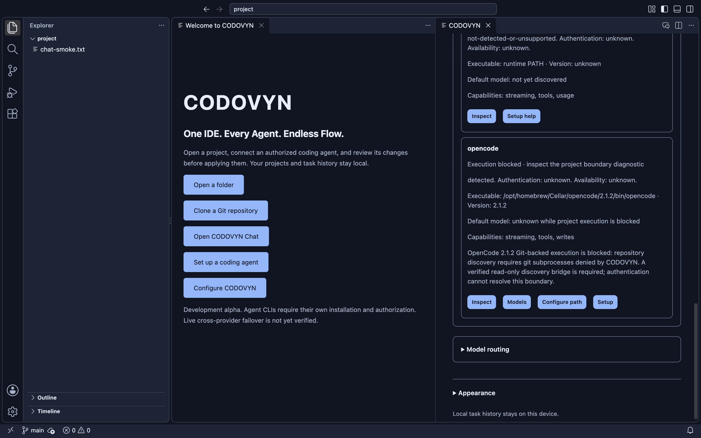

# Phase 12 — real-world ContextFlow validation

## Result: full live milestone BLOCKED

**No live authenticated inference or real Codex → OpenCode continuation was performed.** The owner did not answer the single bounded inference-consent request. Independently, validation uncovered a concrete blocker: **OpenCode 2.1.2 cannot initialize Git-backed projects under CODOVYN's existing process policy.** It requires a Git discovery subprocess that the policy correctly denies. Authentication does not resolve this incompatibility.

This phase delivered targeted security fixes, truthful provider readiness, a reproducible Java/JUnit project, independent correctness oracles, real native IDE checks and a freshly tested development DMG. It does not establish the product's central live multi-agent promise.

## Repository and provenance

- Starting/recoverable checkpoint: `c763f011c541316c57c1f98b2cf86f71b08a07b0`. Clean `main`; correct `origin`; fetch and divergence checks passed without reset or unrelated changes.
- Final implementation/installer source: `5343626a0e773bf3648efbe0166819e78b1d95f5`; embedded **`sourceDirty: false`**.
- Every implementation commit below was tested, pushed directly to `main` and checked against the remote. This report/evidence commit follows the built source. The accompanying completion message records the final remote SHA; resolve the report revision with `git log -1 --format=%H -- docs/development/live-contextflow-validation.md`.
- No feature branch, PR, release, visibility change, history rewrite, credential commit or installer upload occurred. `/Applications/CODOVYN.app`, owner projects/settings and unrelated processes were not targeted. Repository remains private.

```text
4f6ee30 fix(acp): retain provider ownership when cleanup cannot be proven
ebedbfc test(validation): add reproducible Java project and evidence matrix
502d3c3 fix(opencode): report Git project execution as blocked by the process boundary
84ffd48 fix(git): suppress repository fsmonitor execution in host operations
e172570 test(validation): add isolated host JUnit correctness oracles
ecab9d5 test(validation): separate fixture controls from real provider readiness
b1341ac test(desktop): verify Java editing and Maven through the integrated terminal
5343626 fix(providers): avoid presenting stale defaults as current blocked-provider metadata
```

## Validation matrix

| Category | Evidence |
| --- | --- |
| **LIVE VERIFIED** | None. No `session/prompt` or Codex inference request was authorized/run in this campaign. |
| **DETERMINISTICALLY TESTED** | **252 local tests passed**, zero failed/skipped; ACP/ContextFlow/queue/recovery fixtures, real Git worktrees and actual OS boundary denials. Native fixture controls are separate from actual readiness metadata. |
| **METADATA VERIFIED** | Codex CLI 0.164.0; configured session status; seven advertised models, current default `gpt-6.1-sol` supporting High. OpenCode official 2.1.2; ten catalogue entries outside Git, authentication/access unknown. |
| **BLOCKED** | All live Codex/OpenCode scenarios and real continuation: consent absent. Git-backed OpenCode is additionally blocked by the verified process-policy incompatibility. Hosted CI is billing/spending blocked before steps execute. |
| **NOT IMPLEMENTED** | A safely mediated OpenCode Git-discovery path; a completed matched live usage/cost benchmark. Existing packet/approval/continuation logic remains implemented and fixture-tested. |

## Authorization and provider identity

One explicit request proposed **at most six inference turns**: Codex Ask/edit, OpenCode Ask/edit, then Codex start and OpenCode continuation. Proposed per-turn limits were 120 seconds and 12 observed tool starts, with no automatic inference retries. This would use the owner's existing Codex CLI session and only CODOVYN's separate project-scoped OpenCode context. Exact costs and quota use were stated as unknown. No approval arrived; the campaign never started, so these are proposed limits, not a claim of live budget enforcement.

Codex `login status` exited 0 and reported a configured session. Raw output/account identity were omitted; this is not proof of valid inference access or quota. OpenCode authentication remains unknown; no global credentials/plugins/MCP configuration were imported and no credentials were requested, printed or committed.

| Requested scenario | Actual result |
| --- | --- |
| Codex Provider Default + High / Ask | **BLOCKED** pending inference consent; metadata and argument-forwarding fixtures pass |
| Codex Agent / division-by-zero JUnit test | **BLOCKED** pending consent; no live write approval, provider draft, diff or patch application exists |
| OpenCode Ask | **BLOCKED** by consent and Git discovery; no authenticated response/stream |
| OpenCode Agent | **BLOCKED**; Ask prerequisite not met and no policy widening permitted |
| Controlled Codex → ContextFlow → OpenCode | **BLOCKED**; no live logical task/segments, packet review or recipient authorization exists |
| Live cancellation / queue behavior | **BLOCKED**; deterministic process/queue tests do not establish live inference behavior |

No quota exhaustion was fabricated. No provider was substituted to get a successful demonstration.

## OpenCode compatibility investigation

A controlled metadata-only experiment used the **same path and private context**, first without `.git`, then after Git initialization:

- Non-Git directory: **10 models**, default `opencode/big-pickle`, authentication unknown; 2,281 ms.
- Git directory: failure in 242 ms. Bounded debug logging from the fresh context identified `/api/model` HTTP 500 caused by **`EPERM posix_spawn git`** while running `rev-parse --git-dir --git-common-dir --show-toplevel`.
- The [pinned 2.1.2 Git implementation](https://github.com/anomalyco/opencode/blob/v2.1.2/packages/core/src/git.ts) confirms discovery invokes Git after finding `.git`. The [official CLI interface](https://opencode.ai/docs/cli/) and installed `models --help` confirm `--standalone` uses a private server; [ACP](https://opencode.ai/docs/acp/) remains the structured execution interface.

This explains why a catalogue-only inspection outside Git could previously pass while a real coding repository fails. **It is not an explanation of native workspace-search issue #16.** We did not allow unrestricted Git/shell, hide `.git`, change task semantics, import global configuration or remove version/platform restrictions.

`openCodeProjectReadiness` now refuses Git-backed execution before prompting/registration. Provider cards display the blocker; default and cached discovered selections become disabled after inspection. A blocked card no longer promotes a stale catalogue default as current. The underlying Git-discovery mediation remains **NOT IMPLEMENTED**; this is an honest guard/diagnostic fix, not a working OpenCode coding demonstration.

## Confirmed security fixes

1. **ACP cleanup evidence:** `dispose()` previously called the stopped callback from `finally`, even after process cleanup threw. That could cause the task engine to release ownership without proof. The callback now follows successful cleanup and transport drain. The new regression failed before the fix; adapter and engine tests now show no stopped event, a retained lease and rejected duplicate execution on cleanup failure. Test-owned processes are reaped independently afterward.
2. **Git fsmonitor execution:** a controlled repository helper executed during a supposedly read-only snapshot and wrote a disposable marker. Host Git operations, drafts and context source listing now set `core.fsmonitor=false` per command. Regression checks snapshots/diffs/drafts, verifies owner Git configuration remains unchanged and uses normal Git as a positive control. No general claim about every possible Git configuration mechanism is made.

Neither fix weakens provider permissions. No provider write escaped its boundary; no live writes occurred.

## Reproducible Java project and independent correctness

`scripts/prepare-live-validation.js` creates an owner-only disposable project with Java 17 source, Maven, JUnit 5.11.4, Calculator, TaskService and baseline tests. It records a fixed-date Git baseline, working-tree fingerprint, all source hashes and an empty initial live-task list. Tests demonstrate source/baseline reproducibility across directories. Different project roots intentionally have different repository identity fingerprints.

- Baseline commit: `8f16b959763703eab55ea792fc848e1843fed888`.
- Initial fingerprint: `ba70f92ce7412c935007e90eda507898218f48a8c15504cf20dad2167e31a072`.
- Accepted live tasks: **0**. Final original source hashes/fingerprint remain unchanged; no live provider diff exists.
- The subtract bug and missing validation are deliberately untested fixture behaviors, not CODOVYN product defects.

| Independent host check | Observed result |
| --- | --- |
| `mvn -B -ntp -o test` on trusted baseline | Exit 0; **3 passed**, no failures/skips |
| Bounded host Java baseline oracle | Compile/run exit 0; **7 passed**, including four actual OS denial checks |
| Division oracle | **5 passed**, including four boundary checks |
| TaskService negative control | Exit 1 as expected; **5 passed / 2 failed** for missing null/blank validation |
| Host-written correct TaskService in an isolated draft | **7 passed**; draft discarded, original unchanged |

These controls prove the oracle can reject missing behavior and accept a known correction. **The positive patch was written by the host test, not an AI provider, and was never applied to the original.** No completed provider task is inferred from it.

The independent runner uses JDK 21, targets Java 17, disables annotation processing, copies seven pinned local JUnit dependencies and records their hashes. It executes host-owned requirement tests, not provider-modified Maven plugins. Child environments omit account credentials; project writes, ordinary private home/temp reads, shell and network are denied. SDK/system reads remain allowed: this is a targeted test boundary, not a universal arbitrary-JVM sandbox guarantee. Compile/run time and output are bounded; existing process ownership is reused and live group members are audited after cleanup.

Reproduce with the [validation matrix instructions](phase12-validation-matrix.md). The generated run manifest remains local at `/tmp/codovyn-phase12-project.json`; committed evidence contains hashes/counts, not credentials or raw account data.

## Native application and installer evidence

The actual standalone app passed model/effort/mode controls, fixture Chat streaming/text safety, Activity separation, queue controls, history and ContextFlow review/rejection/restoration. Real host inspection then verified the **installed** OpenCode version and actual Git-project blocker. Fixture provider diagnostics are isolated until that real inspection begins; no production transport gate was introduced. The initial mixed-state native test failed when real blocked diagnostics correctly disabled a fixture model; the test transport was separated and the original selection assertions retained.

The native Java smoke opened the reproducible Java source with Java language mode and ran **three JUnit tests successfully through the integrated terminal** using installed Maven/JDK. The Java smoke uses the same source map plus a disposable native text marker. This proves editor/terminal tooling, not semantic Java language-server support, bundled SDKs or AI execution.



The screenshot is window-scoped and comes from the real copied application. The OpenCode installation/blocker diagnostic is actual metadata. Model/Chat controls and persisted conversation in this native harness are fixtures; the image is **not live inference evidence**.

| Check | Result |
| --- | --- |
| Dependency installation with scripts disabled | Passed |
| Baseline / final `npm run check` | 246 / **252 passed**, zero failed or skipped |
| Companion extension-host test | Passed on cached VS Code 1.143.1; nonfatal upstream channel warnings retained |
| Clean desktop build | Passed; source SHA/dirty flag above |
| Source native host, fresh/warm profiles | Passed original search, editor/save, Git, terminal and bundled Node |
| Source native Chat / routing UI / two-launch restoration | Passed; live inference not claimed |
| Package + read-only mount + disposable copy | Passed |
| **Copied app: Java host / Chat with actual readiness / routing / restoration** | **All four commands passed**; Chat and restoration each used two launches |
| Copied signature after tests | Deep/strict verification passed |
| Cleanup | Every recorded final test-owned group exited 0 with **no live survivors**; the read-only metadata-process audit found no remaining OpenCode processes tied to the generated fixtures |

No assertions, deadlines or safety checks were weakened. Native focus was verified where the harness can observe it; no VoiceOver audit is claimed, and issue #15 is not closed.

## Issue #16 bounded diagnostics

The original recursive `workspace.findFiles` assertion remains intact. Earlier-source (`ecab9d5`) fresh/warm profiles measured **99.152 / 127.418 ms** on a one-tracked-file fixture. The copied Java workspace measured **94.636 ms** after an explicit file-service stat readiness check; it contains seven initial tracked files plus Git metadata. The copied routing host measured **56.608 ms** on the text fixture. These differ in workspace/profile/readiness conditions and do not establish a performance improvement or causality.

Phase logs retain activation/readiness, search start, returned promise, delivered response, elapsed time, process ownership and final phase. The existing 60-second search cancellation and 120-second outer deadline remain unchanged. No stall/deadline was observed, so native search cancellation was not newly exercised. Process cancellation/cleanup paths retain deterministic regression coverage. **Issue #16 remains open; no historical root cause or fix is claimed.** Neither the Git security fix nor OpenCode Git incompatibility is presented as that cause.

## Token/cost evidence and benchmark limits

No actual inference input/output/cache tokens, provider latency, billed usage or completed handoff correctness were observed. These values remain **unknown**, not zero estimates. The existing reproducible local benchmark (`node scripts/benchmark-contextflow.js`) ran without inference:

| Synthetic fixture | Full-journal bytes | ContextFlow bytes |
| --- | ---: | ---: |
| short-history | 974 | 1,874 |
| repeated-long-history | 91,319 | 4,689 |

Short context grows due to verification overhead; repeated history shrinks. These are byte counts, **not token/cost savings**. The Java fixture and host oracles provide reproducible correctness subjects for a future matched manual-transfer versus ContextFlow comparison. A live comparative benchmark/automated campaign remains **NOT IMPLEMENTED / pending authorization**; it must not exceed six approved turns or silently add a baseline call. No sourced pricing was used, so no monetary savings are claimed.

## Hosted CI and distribution limits

Hosted runs for the implementation revision are recorded in [machine-readable evidence](live-contextflow-evidence.json). The jobs have **zero executed steps**; the account annotation reports failed payments or spending limits. Workflow definitions remain enabled and unchanged. The owner must resolve GitHub **Settings → Billing & plans** restrictions, then rerun current CI/desktop workflows. We did not change billing or manufacture green checks.

DMG: `dist/desktop/CODOVYN-darwin-arm64-development.dmg`.

SHA-256: `273ae4cd0b9839bfc669e765d9a0cdf9143025fc8a1799d904d3ecbdda58d63c`.

The image passed integrity verification and mounted read-only. The copied bundle passed deep/strict signature verification before and after native checks. Signature is **ad-hoc**; notarization validation returned **65**. It is an unnotarized development installer, not a public production release. macOS `hdiutil` deprecation warnings were nonfatal. No Gatekeeper/Keychain protection was bypassed; native profiles use the existing test-only mock Chromium store and never access the owner's real Keychain. `/Applications/CODOVYN.app` was not replaced. Windows/Linux installed-app support and Intel macOS were not validated.

## Remaining acceptance gates

1. Explicit bounded inference authorization and actual Codex Ask/edit/cancellation/queue evidence.
2. A separately verified OpenCode Git-discovery solution that preserves process/filesystem/tool boundaries, followed by official isolated-context authentication and live Ask/Agent proof.
3. Actual same-task ContextFlow transfer with reviewed recipient-bound packet, one-use authorization, genuine destination progress and independent final-code tests.
4. Matched live usage/correctness comparison and current hosted workflows executing successfully.

Until those gates pass, **the full live ContextFlow milestone is incomplete**. Local fixtures, real OS denials, metadata inspection and native IDE checks are useful evidence, but none substitutes for authenticated continuation.
