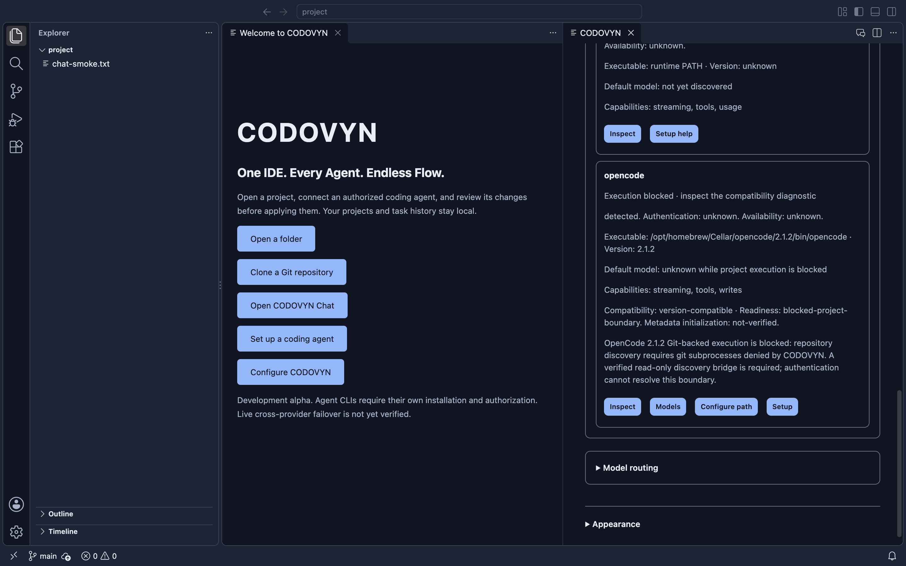

# OpenCode Git compatibility investigation

Phase 13, 2026-10-24. **Production compatibility remains BLOCKED. No live inference authorized or performed.**

Starting source: `515767718b0248c7f172d949b9a8e2d1ee6a155c`, clean `main`, synchronized with `origin/main`. Dependency installation and baseline checks passed: **252 tests, zero failed/skipped**. No branch, PR, release, installed-app replacement, or security-setting change.

## Root cause and integration alternatives

The official macOS ARM64 OpenCode 2.1.2 executable starts its server during `models --standalone`, as well as during ACP initialization. Its project resolver walks upward for `.git`, then invokes literal `git` with `rev-parse --git-dir --git-common-dir --show-toplevel`, using the resolved repository directory as cwd. The child inherits CODOVYN's isolated provider environment. CODOVYN's Seatbelt profile allows only the pinned provider executable; `posix_spawn git` therefore fails with EPERM. This is an intentional process restriction, not an authentication error.

Pinned upstream sources inspected under tag `v2.1.2` in `anomalyco/opencode`:

| Source | SHA-256 |
| --- | --- |
| `packages/core/src/git.ts` | `bfbdc5ea5c8a2bd8c8913ca40c0c1f948f87ee6036d234a1441871622f402f24` |
| `packages/core/src/project.ts` | `73555039b0d9fc6987bf4292ff4b4f521cea32e17449ef93df5800ebaaadb9e0` |
| `packages/core/src/util/git-executable.ts` | `2911263cfeee6e27fee8c6f5a9e611ace97796e7a20f76f57effca20f691aaac` |

Source hashes were independently checked against the official tag on 2026-10-24, resolving to upstream commit `a517687fde98a7329ada3ae644a01a9fc6c4e99e`. The first command is not the entire required interface: project identity can consult the origin remote and root commits, while session metadata can query HEAD and branch. Linked worktrees may require `worktree list --porcelain`. Git-directory and common-directory identity differ for linked worktrees. Commands prefixed with `--git-dir`/`--work-tree` also occur. Snapshot creation and other Git operations must remain disabled or denied, rather than accidentally gaining authority through a general Git exception.

1. **Official capability:** the documented ACP interface accepts a session cwd, not client-provided trusted Git identity. No supported repository-metadata injection or discovery bypass was found in the inspected 2.1.2 path. Hiding `.git` would change repository semantics and is rejected.
2. **Broker:** host-side metadata alone is insufficient; this OpenCode path does not consume it over ACP. Inventing a protocol field would not fix initialization.
3. **Fixed native shim:** an isolated feasibility experiment returned actual host-observed discovery/HEAD/branch/root-commit values from a compiled fixed-purpose executable. It executes no subprocess. With only that literal executable added to the experimental sandbox and a canonical PATH entry, real OpenCode model discovery succeeded in a disposable Git repository. Real Git and shells were not allowed. This establishes consumption feasibility, **not production security approval**.
4. **Pinned source patch:** replacing discovery could provide an explicit trusted interface, but would require maintained upstream changes, reproducible builds, binary provenance and separate review. No patched provider binary was installed or distributed.

The production Git-backed execution guard remains in place while the shim's authority, freshness, executable integrity, environment and linked-worktree boundaries are evaluated. A PATH change alone is not a sandbox. A host-side Git collector would itself need fixed commands, sanitized environment, helper denial, bounded output, safe path resolution and protection against repository-local configuration/includes. Disabling fsmonitor alone does not solve these requirements.

## Evidence categories

- **IMPLEMENTED AND VERIFIED:** existing fail-closed Git-backed execution guard; baseline tests.
- **METADATA VERIFIED:** preliminary native-shim model-discovery experiment, without `session/prompt`.
- **BLOCKED:** production shim/broker approval and Git-backed provider execution until the full boundary is demonstrated.
- **NOT IMPLEMENTED:** public patched-provider distribution, unrestricted Git permission, automatic handoff, or new inference authorization.

Native/package results and measurements below are complete for the recorded development artifact; the Git execution acceptance gate remains incomplete.

## Reproducible probe and production decision

Run `node scripts/probe-opencode-git.js` on macOS ARM64 with Xcode Command Line Tools and official OpenCode 2.1.2 on PATH. The script accepts **no project arguments** and creates all repositories/configuration itself. It compiles/ad-hoc signs a research-only C shim, supplies fixed host-observed metadata, and uses the existing process manager and ACP transport. It does not import owner credentials/configuration, send `session/prompt`, alter the production sandbox, or enable any provider task. Evidence goes to ignored `dist/desktop/opencode-git-probe.json`; [the recorded result](opencode-git-probe-evidence.json) is retained for review.

**METADATA VERIFIED, experimental sandbox only:** ordinary and linked-worktree model discovery and real ACP `initialize` / `session/new` succeeded. Authentication remains unknown. No model inference, account entitlement or live ContextFlow continuation is established.

**DETERMINISTICALLY TESTED with actual native execution:** nine positive cases cover initialized/unborn, committed, feature branch, detached HEAD, linked worktree, spaces, nested directory, separate Git metadata, and non-Git discovery. The non-Git case uses the original production boundary. Fourteen negative groups cover strict command/argument denial, foreign cwd, symlink escape, environment redirection, uninvoked hook/fsmonitor/credential markers, and read-only/draft OS witnesses. Each OS witness denies shell/real Git/other executable invocation, external access, protected Git metadata writes, and shim mutation. A writable-project hardlink witness could neither link nor modify the outside shim. The probe denies remote and worktree-list commands rather than proxying them; the pinned upstream resolver falls back to root-commit/current-worktree identity. That fallback is another compatibility detail requiring review, not complete Git feature support. These are scoped experiment results, not proof that an arbitrary Git broker is secure.

**BLOCKED, with counterexamples:** the immutable-snapshot shim still returns stale branch metadata after an owner-side branch change; accepts a new nested repository as its ancestor; and accepts a new directory at the original pathname. These checks intentionally record unsafe feasibility results rather than passing them off as integration success. All three require a host-verified, race-resistant identity/freshness design before this approach can be considered for production. Further review remains necessary for an untrusted-repository collector, linked-common-directory authorization, executable/dynamic-loader integrity, lifecycle binding and installation/toolchain dependencies.

**Decision:** do not install this shim into the provider boundary. Keep Git-backed OpenCode execution blocked. Do not allow real Git, shells, hooks, credential helpers, fsmonitor, arbitrary provider commands or external metadata access. The script is a minimal reproducible research case, not an executable compatibility bypass exposed to the UI. A hardened broker/shim or a reviewed, reproducibly built upstream compatibility interface is **NOT IMPLEMENTED**. This phase has not resolved the production execution blocker.

## Readiness correction

A confirmed diagnostic defect was fixed: unsupported OpenCode versions previously inherited the project's independent `executionSupported` flag, which could be true outside Git. Status now requires both exact verified version and project compatibility. Separate version compatibility, project readiness and unverified metadata-initialization fields preserve authentication/availability uncertainty. A catalogue or executable presence cannot promote these facts. Native provider settings display the separate states and retain the Git blocker; previously cached model entries remain disabled. The real native Chat harness asserts these fields independently of its provider fixtures.

Source provenance: [pinned Git implementation](https://github.com/anomalyco/opencode/blob/v2.1.2/packages/core/src/git.ts), [pinned project resolver](https://github.com/anomalyco/opencode/blob/v2.1.2/packages/core/src/project.ts), [pinned executable resolver](https://github.com/anomalyco/opencode/blob/v2.1.2/packages/core/src/util/git-executable.ts). Official interfaces reviewed: [ACP](https://opencode.ai/docs/acp/), [CLI](https://opencode.ai/docs/cli/). No undocumented ACP metadata field or terminal-screen scraping was introduced.

## Control and measurement evidence

The [no-shim control](opencode-git-control-evidence.json) starts actual OpenCode with the unchanged production sandbox in a newly created disposable Git repository. `models --standalone --print-logs --log-level debug` exits **1**, with `EPERM` / `posix_spawn 'git'`. This is a deliberately expected failure; it is not reported as successful integration. Its owned group has no survivors. The research probe succeeds only with its additional literal native executable allowance. Canonical paths matter on macOS: an initial exploratory allowance using `/var/folders` rather than its `/private/var/folders` real path still failed; canonicalizing it allowed the native shim to execute. Production restrictions were not changed.

Hardware: Apple M2 / Mac14,2, 8 GiB RAM; macOS 27.0.1 (26A434), ARM64; Node 26.9.0; Xcode Command Line Tools. Resource-intensive native commands ran sequentially. Official installed OpenCode version: **2.1.2**. Executable SHA-256: `3f01e2ba8efd4242c638add9248b88696221d76588d9511e63cb2d727c278fcc`. This identifies the tested installation; it is not a new upstream signature/provenance attestation.

| Observation | Measured result | Scope |
| --- | --- | --- |
| Production no-shim control | 901.94 ms, exit 1 | Reproduced Git process denial |
| Ordinary Git catalogue | 1,627.63 ms | Experimental native shim; ten metadata model IDs |
| Ordinary catalogue + ACP session | 2,191.00 ms | No prompt, authentication unknown |
| Linked-worktree catalogue | 1,024.31 ms | Experimental native shim; ten metadata model IDs |
| Linked catalogue + ACP session | 1,549.39 ms | No prompt, authentication unknown |
| Direct shim discovery probe | 125.68–552.77 ms | Eight interface cases, includes process cleanup and `ps` audit overhead |
| Recorded probe-owned groups | 90, zero survivors | Fixture setup/commands, witnesses and two ACP transports; compiler/signing use the same checked helper but their PIDs are not retained in this list. This is not a count of every internal provider child. |

Only ordinary and linked-worktree cases were tested through actual ACP session creation. The other Git-positive cases verify the shim interface, not complete OpenCode sessions. The non-Git case verifies original-boundary catalogue discovery. Default metadata was `opencode/big-pickle`, with no explicit effort options advertised in these sessions. Neither catalogue presence nor the default proves authenticated access, quota, free inference, live model execution or safe coding. Memory impact, provider tokens/cost, pure Git-discovery latency and before/after performance improvements were **not measured**.

## ContextFlow, queue and permission compatibility

**DETERMINISTICALLY TESTED:** the complete 255-test suite retains recipient/configuration-bound one-use approval, packet integrity, same-task execution segments, stale-fingerprint rejection, pending-write/owner reconciliation, queue immutability and serial dispatch, cancellation, and approved-packet transmission to the ACP fixture. Existing ContextFlow serialization stays bounded at 32,768 bytes and preserves usage provenance. No automatic fallback or permission expansion was introduced.

**NOT IMPLEMENTED / BLOCKED:** a production Codex-to-OpenCode continuation using actual Git-backed initialization. The metadata experiment and deterministic execution tests are separate evidence; they are not combined into a claim of real end-to-end continuation. The production guard stops Git-backed OpenCode before any prompt/lease registration. Ask/Plan filesystem and process denial and draft-scoped writes were exercised with trusted OS witnesses; genuine OpenCode tool execution remains untested. No ambiguous operation was replayed, and no new provider authorization was inferred from a queued task or model catalogue.

## Native application and development DMG

Clean-source build provenance: **`ad57d6a7bfccccc9aed133da4a0c1d49ba244c62`**, `sourceDirty: false`, embedded in `Contents/Resources/codovyn-build.json`. The final report/evidence commit follows that source revision; the final remote history SHA is recorded in the completion message. [Native evidence](opencode-git-native-evidence.json) records copied provenance, test summaries and retained lifecycle results.

| Check | Actual result |
| --- | --- |
| `npm ci --ignore-scripts` | Passed; dependency audit findings below |
| Baseline / final `npm run check` | **252 / 255 passed**, zero failed or skipped |
| `npm run test:extension-host` | Passed on cached VS Code 1.143.1 |
| `npm run build:desktop` | Passed from clean source |
| `npm run test:desktop-host` | Passed editor/save, original recursive search, Git, terminal and bundled Node |
| `npm run test:desktop-chat` | Passed two launches, real blocked-provider status plus fixture transcript/queue/ContextFlow checks |
| `npm run test:desktop-routing-ui` | Passed real native webview assertions; DOM focus observability unavailable |
| `npm run test:desktop-restoration` | Passed two-launch workspace/editor/theme/routing restoration |
| `npm run package:desktop` | Passed; image integrity verified |
| Read-only DMG mount and disposable app copy | Passed; mounted image detached |
| **Copied app host / Chat / routing / restoration** | **All passed**, sequentially; Chat/restoration each used two launches |
| Copied Java workflow | Native editor and terminal, independent Maven/JUnit result: **3 tests**, exit 0 |
| Copied signature before/after tests | Deep/strict verification passed |
| Test-owned cleanup | Six copied native groups exited 0, no survivors; source retained groups likewise exited 0 with no survivors |

The screenshot is from the actual copied standalone app, captured through its owned window target. The OpenCode installation and blocked-readiness fields are real metadata. Chat/history/queue contents in this native harness use deterministic fixtures, **not live model execution**. No owner projects or credentials were used. No VoiceOver certification, full routing accessibility closure, or semantic Java language-server support is claimed.

DMG: `dist/desktop/CODOVYN-darwin-arm64-development.dmg`.

SHA-256: **`8d082ee63ac7da0eea3bd62b781e099633425033ee16d64275a962efba6970b4`**.

The bundle is **ad-hoc signed and unnotarized**; notarization validation returned 65. It is a development installer, not a public release. `/Applications/CODOVYN.app` and owner settings were not modified. No Gatekeeper, Keychain or other macOS protection was bypassed. Nonfatal upstream channel/deprecation warnings, Electron's forwarded mock-Keychain-switch warning, copied-app sandbox-extension startup warning and hdiutil warnings remain in local logs. Windows/Linux and Intel macOS were not validated.

## Issue #16 and hosted CI

Issue [#16](https://github.com/Gautam-aman/CODOVYN/issues/16) remains **OPEN**. The source native host's unchanged recursive search measured 95.87 ms; the copied Java workspace measured 319.27 ms after a file-service stat readiness gate; copied routing measured 77.51 ms. These are different fixture/readiness conditions, not a comparable performance benchmark. No stall occurred in this bounded set. Original cancellation/deadline assertions and isolated process cleanup remain intact; no historical cause or resolution is claimed. The Git startup denial is a separate issue.

Hosted [CI run 40075837236](https://github.com/Gautam-aman/CODOVYN/actions/runs/40075837236) for the built source failed **before all three platform jobs executed any steps**. The annotation reports failed account payments or spending limits. The earlier [desktop workflow](https://github.com/Gautam-aman/CODOVYN/actions/runs/40075307853) is also blocked. The owner must resolve GitHub **Settings → Billing & plans** restrictions and rerun current workflows. Workflows and billing settings were not changed. **Local validation passed. Hosted CI could not execute because of account configuration.**

`npm audit` additionally reports **two high-severity development dependency findings** through `@vscode/vsce → @azure/identity → @azure/msal-node`, including [GHSA-xcx6-jx8p-x3h5](https://github.com/advisories/GHSA-xcx6-jx8p-x3h5). They were not suppressed or remediated with an unreviewed dependency upgrade. The desktop extension assembly excludes repository `node_modules`; this observation is not an audit of all upstream editor dependencies. Dependency remediation remains a separate known limitation.

## Bounded live-validation plan — not authorized or executed

Only after production compatibility is established, request **one explicit owner authorization** for at most six inference turns:

1. Codex Ask, provider default, High only if advertised: inspect the disposable Java project.
2. Codex Agent: one isolated JUnit edit, reviewed rejection/acceptance checks.
3. OpenCode Ask using the freshly verified project default.
4. OpenCode Agent: one approved draft-only change.
5. Codex: bounded first step of the original validation task.
6. OpenCode: same-task continuation using the exact reviewed ContextFlow packet and recipient-bound one-use approval.

Account contexts: the owner's official Codex CLI session and CODOVYN's separate owner-only OpenCode context. Neither authenticated execution nor model entitlement was established here. Refresh metadata before approval; the experimental observed OpenCode default is not a promised usable model. Existing account quota or billing may be consumed; exact prices and total cost are **unknown**.

Proposed limits are 120 seconds per turn, at most eight observed tool starts per turn, minimal disposable Java context and the existing 32,768-byte packet bound. A live runner must enforce those action/time bounds, reject unsupported capabilities, stop at ambiguous writes and obtain normal Agent/transfer approvals; that bounded live runner has not been delivered by this research probe. Reuse existing owned-process cleanup and stop the campaign on authentication, isolation or cleanup failure. No automatic retries, additional baseline calls, permission widening or account switching. Authentication must use official local setup, never passwords/API keys pasted into Chat.

## Git and outstanding acceptance gates

Implementation commits:

- `a508057e5305122aa20d85c1d729b2c67cb5249f` — correct independent provider readiness and native assertions.
- `3589daffc934e49eab02be583c8f911f4e19a0d2` — reproducible constrained-shim feasibility and integrity counterexamples.
- `ad57d6a7bfccccc9aed133da4a0c1d49ba244c62` — bounded research cancellation, denial evidence and provider guide.
- The enclosing final documentation commit records native/control evidence, screenshot and installer verification.

Each completed step was tested, committed directly to `main`, pushed and remote-verified. No branch, PR, release, visibility change or generated installer commit occurred. Final branch cleanliness and exact `origin/main` SHA are checked after the report commit and stated in the completion response.

**Still incomplete:** a race-resistant, independently reviewed production metadata broker/shim (or reproducible pinned upstream interface), actual safe Git-backed OpenCode task execution, actual cross-provider continuation and explicitly authorized live correctness/usage measurements. This phase provides a causal reproduction, a rejected candidate with concrete counterexamples, a readiness fix, native regression evidence and a fresh verified development artifact. It does **not** claim to have resolved the production OpenCode blocker or met the full Phase 13 execution acceptance criteria.
