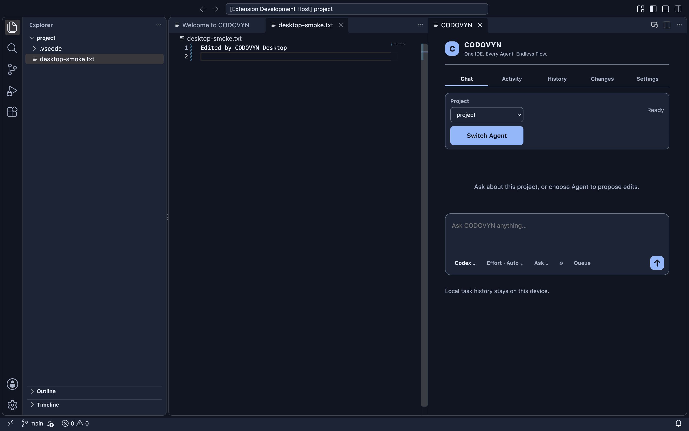

# Phase 16 — pre-action controls and durable request accounting

**PREPARED — NOT EXECUTED. Actual live model requests: 0.**

Production Codex and OpenCode prompting remains **BLOCKED**. The new accounting and pre-action research boundary are implemented; authenticated inference, live coding and live ContextFlow are not verified. No spending approval was received, no credential contents were read or imported, and no provider prompt was sent. A generic “continue” does not authorize inference.

## Repository and implementation

This continuation started from `05bb0a72b1d93864718d673f47e691ba4f0d5024`, verified on `main` against `origin/main`. Existing history and work were preserved. Earlier Phase 16 preparation is recorded in that revision of this report.

- `66a81c6cadd1d88c24dc246154607e8451e7b137` — host-only campaign review capabilities, SQLite reservations/outcomes, task-bound dispatcher, private process lifecycle identity, Codex pre-action controls, real metadata/task preflight harnesses and regression tests.
- `e6339e1c6880b52ab7f270db2606e702652bd73a` — require live consent before real-provider MCP activation; protect credential renaming and configuration writes.
- `3c3073447166f9a10f7bf562d80641f12bda7ec5` — bounded native source-read failure diagnostics; no timeout or permission changes.

- `96bc451e86f72b52bacaacee75c6c52cdf2802e6` — crash-fixture cleanup verifies actual group disappearance after transient Darwin signal denial.

- `34002abf3dac9ca4a4689b7997108ce98e6aae73` — race-barrier loops terminate on a signalled witness; deadlines and race assertions are unchanged.

The final implementation/build SHA is `34002abf3dac9ca4a4689b7997108ce98e6aae73`. A subsequent evidence-only commit contains this report and screenshots; resolve its full SHA with `git log -1 --format=%H -- docs/development/phase16-live-multiagent-validation.md`. The final response records the verified remote SHA. No branch, PR, release, generated app/DMG commit, or `/Applications/CODOVYN.app` replacement was made.

## Codex pre-action boundary

**DETERMINISTICALLY TESTED / REAL OS SECURITY VERIFIED:** command and file-change approval requests receive cancellation; permissions requests receive no grants; dynamic tools fail; unknown methods receive an error. Approval events alone cannot prevent every provider action. The independent macOS process/filesystem policy is therefore enforced before the provider executes.

The pinned official native Codex `0.164.0` executable SHA-256 is `d8990e3ee7acfbc26f91265b12a1a83f0fee40d0e0f8f1f40a37d4ec21f499cf`. Its fresh private home is outside the project; no global credentials/configuration are imported. The process receives only a fixed environment. Shell, unified execution, nested agents, apps, plugins, computer use, shell snapshots, sleep tools and web search are disabled in its protected configuration. The official app-server also receives read-only, user-reviewed, on-request thread policy. Actual model/configuration/thread replies are checked, rather than assuming requested settings took effect.

The sandbox denies process forks and executable launches except initial launch of the exact native executable; project source, external private data, credential files, Git metadata writes, configuration modification and hardlink escapes remain denied. Only its disposable non-secret state is writable. Known secret-path protection is not perfect content classification. Public runtime/library reads remain necessary; this is not a general-purpose secure Agent editing adapter.

A narrow macOS dyld exception permits reading the root directory object `(literal "/")`, not recursively reading its contents. Without it, the secured runtime aborted during dyld bootstrap. Real sandboxed Node and independently compiled native witnesses demonstrate denied private/project reads, credential renaming, shell/Git/curl/other executable launches and configuration writes while the runtime can start. This does not establish immunity from every OS/runtime vulnerability.

The CLI configuration parser rejects `untrusted` despite its appearance in protocol types; the verified configuration uses `on-request` with independent OS denial. It also rejects overriding its built-in `openai` provider. Internal provider retries therefore remain **unknown**, not guaranteed zero. Official protocol reference: [Codex app-server](https://learn.chatgpt.com/docs/app-server); installed CLI schemas and actual replies determine this pinned integration's supported fields.

**METADATA VERIFIED:** the new connection privately owns its child, stdin, request map and lifecycle. It admits only `initialize`, `model/list`, `config/read` and `thread/start`, once each. `turn/start` is rejected. Limits are 15 seconds, 256-KiB lines, 2-MiB total stdout, 256 messages and bounded sanitized diagnostics. Cancellation reaps only owned groups. Public lifecycle wrapper mutation cannot replace the privately captured cleanup function; actual ChildProcess identity is required.

**BLOCKED:** the legacy real `exec --json` adapter now refuses before spawning or registering inference. Fixed host-only Node fixtures remain supported. No live app-server turn transport/stream decoder is armed. The isolated context has no verified authentication. File-based credential access is intentionally denied; granting it or importing global credentials is not an accepted workaround. Codex Agent writes and paid requests are not enabled.

## Durable consent and submission accounting

**DETERMINISTICALLY TESTED:** the existing private TaskStore SQLite database now holds versioned campaign consents and request rows. There is no second journal. WAL/FULL-sync transactions atomically persist request reservations and task events before transport invocation.

Consent binds the logical task, provider, exact model/effort, mode, repository root/fingerprint, accepted configuration digest, executable SHA, account-context digest, source-scope digest, exact prompt SHA, limits and expiry. The host-only review and approval are opaque one-use capabilities; JSON, booleans, expired reviews and replayed approval objects are rejected. Tests supply fixture callbacks. A production renderer command/native campaign confirmation UI is not wired, and no actual owner consent has been issued.

A current execution lease, actual bound provider process and accepted task policy are required. Reservation uses `BEGIN IMMEDIATE`, immutable IDs, unique task/segment and consent/ordinal constraints. A pending or uncertain request fences further submissions across the journal. Completed, failed and pre-wire cancelled reservations remain spent. Spending history cannot be pruned through normal task deletion. This conservative retention/fencing currently requires explicit future reconciliation rather than automatic reset.

States are `reserved → submitting → confirmed → completed/failed`, with conservative `uncertain` outcomes for disconnect, deadline, cancellation after submission intent, or dead-owner recovery. Cancellation before submission is recorded separately. A durable submitting intent is not proof that bytes reached a provider; an explicit acknowledgement is tracked independently. Late/duplicate acknowledgement is refused. No uncertain operation is replayed or refunded after restart. Foreign hosts, PID reuse or unverifiable process death retain the fence and execution ownership.

The task-bound dispatcher verifies the approved prompt and repository before reserving, then rechecks before the single transport invocation. It bounds local execution, polls revocation, stops the privately registered lifecycle, and does not release TaskEngine ownership itself. Cleanup failure retains the fence. A local watchdog cannot guarantee remote computation or billing stops immediately.

Real-provider MCP tool activation and each file call independently require live consent and a submitting/confirmed durable request. Existing fixed Node fixtures are a host-only testing seam, not a renderer preference. Durable MCP reservations precede file access and supplement the existing eight-call ceiling. Denied attempts within the budget count; metadata catalogue operations cannot replenish it.

Accounting distinguishes reservation count, submission intent, acknowledged submissions, outcome, and host-reserved MCP attempts. **Internal inference turns, tokens and billing remain unknown.** One approved submission is not a guarantee of one internal model call or one billing unit. No usage or savings claims are made.

Tests cover exhaustion, two database connections, duplicate dispatch, cancellation before/after acknowledgement, deadline, changed model/provider/prompt/executable/scope, expiry/revocation, SIGKILL before/after submission intent, database reopen, retained ownership, privately captured cleanup, MCP denial before source access and TaskEngine lifecycle integration.

## Java, providers and ContextFlow

The deterministic Java division fixture is reproducible, secret-free and uses Maven offline with cached pinned dependencies. Compilation targets Java 17; this machine runs JDK 21.0.7. Three baseline tests pass; the independently added zero-divisor oracle fails before the host reference fix and four tests pass afterward. Providers did not produce that reference fix.

Real secured Codex metadata identifies default `gpt-6.1-sol`; Low and High are advertised effort choices. Model catalogue presence does not establish entitlement or billing. The TaskEngine metadata harness binds the actual Codex process and original repository, performs an authorized **host-only** 229-byte Calculator read, denies `.env`, refuses `turn/start`, and releases its lease only after cleanup. Source bytes are not delivered to a model.

OpenCode remains pinned to official macOS ARM64 `2.1.2`, SHA-256 `3f01e2ba8efd4242c638add9248b88696221d76588d9511e63cb2d727c278fcc`. Real ACP initialization/model discovery uses its separate private context; authentication and inference entitlement remain unknown. Catalogue/default selection is not a successful paid request.

Existing repository descriptor authority, branch freshness, linked worktrees, nested repository rejection, path substitution, controlled races, library injection denial/control, process ownership and cancellation are retained. ContextFlow fixture assertions follow real ACP startup but remain **DETERMINISTICALLY TESTED**, not live handoff. Same-task segments, immutable recipient-bound packets, one-use approval, repository fingerprints, queue ownership and restart safeguards remain enforced. No automatic provider switching is enabled.

The Java read/edit/test/review actor is a fixed Node protocol fixture. It exercises actual task authority, native file mediation, SQLite write intents, conflict checks, isolated drafts, independent Maven tests and accept/reject review. It does not prove an AI provider can choose or use these tools successfully.

## Validation results

| Check | Final result at clean `34002ab` |
| --- | --- |
| `npm ci --ignore-scripts` | Passed; package and lock files unchanged throughout these commits; two high development findings retained |
| `npm run check` | **179 syntax files; 357 passed, 0 failed/cancelled/skipped**; test duration 296.871 seconds |
| `npm run test:extension-host` | Passed, VS Code 1.143.1; teardown emitted a nonfatal blocked-webview diagnostic |
| Secured Codex metadata / TaskEngine preflight | Both passed; only four metadata methods, no turn, original unchanged, cleanup verified |
| OpenCode broker | Seven real metadata ACP sessions and six transitions passed |
| OpenCode actual adapter | Ask/Agent initialization passed in source and copied packages; prompt blocked in all four sessions |
| Deterministic Java/MCP workflow | Source and copied packages passed accept/reject; two published intents and four independent passing JUnit tests per workflow |
| `npm run build:desktop` | Resumed build passed, embedded clean `34002ab` |
| `npm run test:desktop-host` | Source and copied app passed editor/search/Git/terminal/Node; Java editor and offline Maven: three baseline tests, exit 0 |
| `npm run test:desktop-chat` | Source and copied app passed both launches, model/effort/mode/composer/history/queue/ContextFlow assertions and blocked real OpenCode readiness |
| `npm run test:desktop-routing-ui` | Source and copied app passed routing, Activity follow and local history filters; DOM focus observability remains unavailable in the isolated harness |
| `npm run test:desktop-restoration` | Source and copied app passed both launches |
| `npm run package:desktop` | Passed; fresh development image integrity verified |
| Copied packaged Codex controls | Both harnesses passed using copied package imports and bundled Node; metadata and host-only source read, no inference |
| Signatures / owned cleanup | Mounted, copied and post-test deep/strict signatures passed; 12 native lifecycle records have no survivors; 308 recorded groups absent in final read-only verification |

[Regression summary](../assets/phase16-controls/regression-summary.json), [source stage outcomes](../assets/phase16-controls/source-stage-results.json), [source broker](../assets/phase16-controls/source-opencode-broker-validation.json), [source Codex task proof](../assets/phase16-controls/source-codex-task-control-validation.json), [copied Codex task proof](../assets/phase16-controls/copied-codex-task-control-validation.json), [copied OpenCode adapter](../assets/phase16-controls/copied-opencode-task-execution-validation.json), [copied Java fixture workflow](../assets/phase16-controls/copied-opencode-draft-workflow-validation.json), [cleanup verification](../assets/phase16-controls/cleanup-verification.json).

The copied harness manifest records the exact import-rebound harness hashes and copied package root. It reuses existing test infrastructure; it is not a second provider runtime. Native application screenshots below come from the copied standalone binary under its native test host and contain deterministic test state. They do **not** show live provider execution:

[Fixture model picker](../assets/phase16-controls/copied-fixture-model-picker.png), [fixture effort menu](../assets/phase16-controls/copied-fixture-reasoning-effort-menu.png), [fixture queue](../assets/phase16-controls/copied-fixture-task-queue.png).

Earlier unsuccessful validation remains material: one full run failed the deterministic Java MCP workflow with a generic disconnect; a later run failed crash/write checks and a native compiler deadline with 187 seconds elapsed. Host suspension was suspected but not established. An unchanged subsequent suite, run under a temporary process-scoped idle-sleep assertion, passed all 357 tests. No test deadline was raised, failed assertion removed, or persistent macOS setting changed.

The first clean `e6339e1` standalone Codex TaskEngine probe also failed a source read before returning bytes. It sent zero prompts and made no project mutation. The new diagnostic records only helper status/signal/deadline/byte counts; its subsequent focused probe and all 12 file-access tests passed. This does not prove the intermittent failure's root cause or justify a reliability claim. The failed observation is documented here; that generic error did not record the native helper outcome. A subsequent full run at `3c30734` had 356 passes and one crash-fixture cleanup error (`kill EPERM`). Its fixed cleanup now independently checks actual recorded group membership after signalling; a permission error alone never establishes cleanup. All three focused hard-crash cases passed after this change. The next full attempt was cancelled after a race-barrier loop hung: it checked `exitCode` but not `signalCode` after the existing deadline killed its helper. The bounded-state fix passed all 12 focused identity tests. This fixes the harness hang, not the reason for slow helper startup.

The initial orchestration process exited 143 (SIGTERM) during assembly after its completed tests; the termination source is unknown. That incomplete build was not validated or labelled successful. Work resumed at the build stage, without rerunning completed checks.

Installer and copied application:

- DMG: `dist/desktop/CODOVYN-darwin-arm64-development.dmg`.
- SHA-256: `dba86d3700e0360a4175f7ba895f13945df3839159b6f6d3710f137e11a54f52`.
- Embedded source: `34002abf3dac9ca4a4689b7997108ce98e6aae73`, `sourceDirty: false`.
- Disposable copy: `/private/tmp/codovyn-phase16-final-copy-umrjq_41/CODOVYN.app`.
- Read-only image mount, mounted bundle verification, copy, detach, copied launch tests and post-test signature all passed. `hdiutil` emitted deprecation notices; integrity checks succeeded.
- Ad-hoc signed, unnotarized, local development artifact. No installer publication, Gatekeeper/Keychain setting change, or installed-app replacement.
- The original `**/desktop-smoke.txt` search assertion remains intact. Source search completed in 119.330 ms and copied search in 110.068 ms; neither observation proves the intermittent issue cannot recur.

[Installer verification and copied-test outcomes](../assets/phase16-controls/installer-verification.json), [clean build provenance](../assets/phase16-controls/build-provenance.json), [copied host result](../assets/phase16-controls/copied-host-result.json).

## First single-request proposal — not authorization

[Exact proposed prompt and local limits](../assets/phase16-controls/single-request-proposal.json). This data file is not an approval or dispatch capability.

**PREPARED — NOT EXECUTED / BLOCKED pending prerequisites.** Only one initial Codex Ask submission is proposed, not the earlier six-submission campaign:

- Provider: pinned Codex CLI `0.164.0`; model `gpt-6.1-sol`; reasoning Low, subject to fresh catalogue validation.
- Account: a separately owner-authorized, isolated official Codex context. Authentication is currently unverified; existing global credentials will not be imported.
- Input: the approved disposable Calculator excerpt only, 229 bytes, SHA-256 `dee76c8f9584ba9286e2bd67948499030760f3978bb6a3e4074cbcf731088c26`.
- Request: “Explain the division-by-zero behavior in the following approved Java excerpt and recommend the smallest safe correction. Do not call tools or modify files.” Followed by the named source excerpt. Exact prompt SHA-256: `dfe2704168df0eb12655b1a5401b9b41aff59331519b03e4b0189c307f33cc96`.
- Local limits: one durable outer submission, 120-second watchdog, zero MCP calls, zero tool approvals, no host retry, fallback, parallel request, edits, commit or push. Cancellation must preserve uncertain accounting and reap owned processes.
- Unknown limits: internal provider calls/retries, token usage, exact cost and quota impact. It may consume subscription quota or API credits; no price or guaranteed token/billing cap is claimed.

Before submitting, verify isolated authentication without exporting credentials, implement and independently validate the narrowly guarded live turn transport, obtain explicit approval of this exact scope, create fresh task/lease/expiry/repository bindings, and durably reserve the request. Current metadata-only code cannot submit it. Approval cannot silently expand this into an Agent task, different model/account, OpenCode request or ContextFlow transfer. No additional turn/retry is authorized by a failure.

**Do not treat this report as a request already sent or consent already granted.** A separate owner response is required before any model request. If the authentication and guarded transport prerequisites remain unresolved, keep the request blocked even if the owner approves spending.

## Remaining limitations

**BLOCKED:** authenticated live Codex/OpenCode, actual provider file-tool use, live editing and real Codex→OpenCode continuation; narrow live-turn wiring and isolated authentication; intermittent native helper failure classification. General production coding remains disabled. Supported scope is macOS ARM64 only; no public production readiness or notarization is claimed.

Hosted CI is separate from local tests. The [latest inspected source run](https://github.com/Gautam-aman/CODOVYN/actions/runs/40268107152) at `34002ab` had zero executed steps; GitHub reports failed recent account payments or an insufficient spending limit. The owner must resolve Billing & plans/payment/spending configuration to let jobs start. No workflow was disabled and no billing settings changed. Issue #16 remains OPEN; passing bounded workspace-search runs do not establish its root cause or resolution. The two documented high development dependency findings (`@azure/identity`, `@azure/msal-node`) remain disclosed in the [current audit summary](../assets/phase16-controls/dependency-audit-summary.json); no unsupported overrides or unrelated dependency churn were introduced.

## Public-alpha engineering supplement — 2026-10-26

The preceding Phase 16 checkpoint remains historical. The current alpha sprint starts at `f009b9e64c15381c65a562499f201c17483180e4`; implementation source is `1356a7544cc14cd3c44c3a214fc7969c3dc61e40`. See [current release qualification](../release/PUBLIC-ALPHA-READINESS.md) and [machine-readable evidence](../assets/public-alpha/qualification.json) for commit/build provenance and copied-app results.

**IMPLEMENTED / DETERMINISTICALLY TESTED:** official process-memory-only Codex device login, native owner initiation, logout/cancellation, exact single-Ask native review, private guarded `turn/start`, early/final-only/repeated-final event normalization, UTF-8 streaming, durable reservation/acknowledgement/terminal/uncertain accounting, TaskEngine process binding and denied tool actions. Fixed protocol actors exercise the transport; they are not a model response. Full regression now has 380 passes with no failures/skips; final text-only onboarding change also has 45 passing overlapping extension checks.

**REAL OS / METADATA VERIFIED:** empty isolated account reports unauthenticated; no sign-in request was initiated and no credentials were imported. Native worker startup/EOF, pinned Codex metadata/task policy, real Git-backed OpenCode ACP initialization, repository broker/ownership cleanup and deterministic draft/Maven oracle are qualified separately. Runtime hardened entitlements retain JIT only. The separate Node security pin is updated to 26.12.1; upstream Electron's embedded Node patch coverage is still a release blocker.

**LIVE INFERENCE UNVERIFIED / BLOCKED:** zero model requests, zero paid execution, no actual Agent edit, no live cross-provider ContextFlow. General coding remains guarded. Owner-initiated isolated authentication and explicit approval of the exact one-submission, zero-tool, 120-second Ask proposal in the release report are still required. That approval does not authorize Agent edits, retries, another model or handoff. After Ask, restricted Agent integration and a separately approved genuine coding test remain mandatory.

**DISTRIBUTION BLOCKED:** ad-hoc development DMG only; no credentialed signing/notarization, second-Mac Gatekeeper qualification, rights clearance or passing hosted CI. No release/website/visibility change or installed-app replacement occurred. The final remote SHA is reported after pushing the evidence commit; the installer embeds its earlier clean implementation SHA.
